# TapOrder — hành trình sản phẩm từ A đến Z

DESIGN-1. Người mới có thể đọc trang này trước; chi tiết kỹ thuật ở [system design](system-design.md) và [12 feature designs](README.md). Đây là luồng cần triển khai, chưa phải bằng chứng app chạy. [Bản SVG để phóng to](assets/product-flow.svg) được render từ đúng khối Mermaid dưới đây; sửa nguồn thì render lại SVG.

## Câu chuyện sản phẩm

**A — Chuẩn bị:** người vận hành migrate/seed đúng hai bàn1/3 và hai tài khoản staff. Nhân viên đăng nhập, role server quyết định màn hình. Thu ngân mở ca và xuất QR; pha chế mở hàng đợi. Không có bill/order giả từ seed.

**B — Khách gọi món:** quét QR của bàn, hệ thống xác nhận đúng bàn và tạo phiên khách ẩn danh. Nếu bill đang mở, khách xác nhận tham gia; chưa có bill thì chỉ xem menu. Khách chọn món/quantity/note rồi gửi. Server kiểm ca, bàn, bill dự kiến, giá/còn hàng; sai giữ giỏ, không nhận một phần. Thành công mới lưu hóa đơn/lượt gọi/dòng chờ.

**C — Pha chế và khách theo dõi:** pha chế thấy ticket theo FIFO, bấm bắt đầu rồi xong từng dòng. Khách xem toàn bill và chỉ hủy dòng của mình còn chờ; tranh chấp với pha chế chỉ một thao tác thắng. Pha chế bật/tắt hết hàng tác động lượt gọi sau. SSE thông báo refetch; mất SSE có polling, không tự tạo lại order. Khách có thể gọi thêm cùng bill mở.

**D — Thu tiền:** thu ngân đọc tổng từ server, chỉ xác nhận tiền mặt khi mọi dòng xong/đã hủy. Tổng loại dòng hủy, bill toàn hủy vẫn payment0. Server lưu một payment và bill paid nguyên tử. Mất mạng lúc gửi lệnh phải thử lại cùng mã lệnh/đối soát trước khi gửi mới, không thu tiền lần hai.

**E — Lượt mới hoặc kết thúc:** tab cũ là biên nhận read-only. QR vẫn dùng được nhưng không tự tạo bill; khách xác nhận lượt mới rồi submit mới sinh bill khác. Thu ngân đối soát ca (báo cáo chi tiết P2), chỉ đóng khi hết bill mở, cuối cùng logout. Không sửa/mở lại bill đã thanh toán.

## Quy ước vẽ duy nhất

| Hình / tên | Ý nghĩa |
| --- | --- |
| Bo tròn `(["..."])` | Bắt đầu, kết thúc, dừng một nhánh |
| Chữ nhật `["Chủ thể Động từ + đối tượng"]` | Hành động của khách/nhân viên/hệ thống |
| Thoi `{"Hệ thống Câu hỏi?"}` | Quyết định; mọi nhánh có nhãn rõ |
| Trụ `[("PostgreSQL Dữ liệu được lưu")]` | Dữ liệu commit bền vững, không phải bộ nhớ UI |
| `-->` | Bước tiếp theo; nhãn “Sau đó…” chỉ thao tác ở request/thời điểm khác |

Không dùng mũi tên hai chiều, nét đứt hoặc cùng hình cho nhiều nghĩa. Màu chỉ hỗ trợ: xanh dương hành động, cam quyết định, tím dữ liệu, xanh lá điểm đầu/cuối; in đen trắng vẫn đọc được. Tên hóa đơn=bill, lượt gọi=order, dòng món=order item đúng glossary. ID A01…E09 ổn định để trao đổi; nhãn có Fxx để tra đặc tả. Điểm bo tròn “Tiếp tục tại B01/B07/C01” kết thúc nhánh hiện tại và chỉ rõ bước quay lại, tránh mũi tên kéo xuyên toàn trang. Một mũi tên không có nghĩa giữ HTTP/DB transaction xuyên suốt đến bước kế tiếp.

## Sơ đồ Mermaid A–Z

```mermaid
flowchart TD
  subgraph A["A · CHUẨN BỊ QUÁN VÀ NHÂN VIÊN"]
    A01(["A01 · BẮT ĐẦU<br/>Chuẩn bị một buổi phục vụ"])
    A02["A02 · Người vận hành<br/>Migrate và seed bàn 1, bàn 3, menu, hai tài khoản"]
    A03["A03 · Nhân viên · F02<br/>Đăng nhập bằng tài khoản riêng"]
    A04{"A04 · Hệ thống<br/>Đăng nhập hợp lệ?"}
    A05["A05 · Hệ thống<br/>Hiện lỗi đăng nhập, chưa cấp phiên staff"]
    A06{"A06 · Hệ thống<br/>Vai trò nhân viên là gì?"}
    A07["A07 · Thu ngân · F08, F10<br/>Mở ca và xuất QR đúng từng bàn"]
    A08{"A08 · Hệ thống<br/>Ca đã mở và QR đã sẵn sàng?"}
    A09["A09 · Thu ngân<br/>Xem lỗi, kiểm tra ca hoặc cấu hình QR rồi thử lại"]
    A10(["A10 · PHA CHẾ SẴN SÀNG · F05<br/>Mở hàng đợi, khi có đơn tiếp tục tại C01"])
  end
  subgraph B["B · KHÁCH VÀO ĐÚNG BÀN VÀ GỬI MÓN"]
    B01["B01 · Khách · F01, F02<br/>Quét QR bàn, mở menu không cần đăng nhập"]
    B02{"B02 · Hệ thống<br/>QR hợp lệ và bàn đang bật?"}
    B03(["B03 · DỪNG NHÁNH KHÁCH<br/>Báo QR không hợp lệ, liên hệ thu ngân"])
    B04["B04 · Hệ thống · F01<br/>Xác nhận bàn và tham gia bill mở nếu có, chưa tạo bill mới"]
    B05{"B05 · Hệ thống<br/>Lượt bàn vẫn khớp lúc xác nhận?"}
    B06["B06 · Khách<br/>Xác nhận lại lượt bàn hiện tại, giữ giỏ chưa gửi"]
    B07["B07 · Khách · F03, F11 P2<br/>Xem menu, chọn món, số lượng và ghi chú"]
    B08["B08 · Khách · F03<br/>Gửi giỏ hoặc gọi thêm với cùng mã lệnh khi thử lại"]
    B09{"B09 · Hệ thống<br/>Ca, phiên, quyền, lượt bàn, món và giá đều hợp lệ?"}
    B10["B10 · Hệ thống<br/>Chưa nhận lượt gọi, giữ giỏ và chỉ rõ lỗi cần sửa"]
    B11[("B11 · PostgreSQL<br/>Lưu bill mở nếu chưa có, lượt gọi và dòng món chờ nguyên tử")]
    B12["B12 · Hệ thống · F09<br/>Sau commit, thông báo cập nhật để các màn tải dữ liệu mới"]
  end
  subgraph C["C · PHA CHẾ, THEO DÕI VÀ GỌI THÊM"]
    C01["C01 · Pha chế · F05, F06<br/>Xem hàng đợi FIFO và bật hoặc tắt còn hàng khi cần"]
    C02["C02 · Pha chế · F05<br/>Dòng chờ bấm Bắt đầu, dòng đang pha bấm Xong"]
    C03{"C03 · Hệ thống<br/>Trạng thái và version còn khớp thao tác?"}
    C04["C04 · Hệ thống<br/>Báo xung đột, pha chế tải lại trạng thái hiện tại"]
    C05[("C05 · PostgreSQL<br/>Lưu chờ thành đang pha, hoặc đang pha thành xong")]
    C06["C06 · Khách · F04, F09<br/>Xem bill và tiến độ qua SSE hoặc tải định kỳ khi mất kết nối"]
    C07{"C07 · Khách<br/>Muốn làm gì tiếp?"}
    C08{"C08 · Hệ thống · F04<br/>Dòng là của khách, còn chờ và bill còn mở?"}
    C09[("C09 · PostgreSQL<br/>Lưu dòng đã hủy và loại dòng đó khỏi tổng")]
    C10["C10 · Hệ thống<br/>Báo không thể hủy, tải lại trạng thái, giữ dữ liệu"]
    C11(["C11 · GỌI THÊM · F03<br/>Tiếp tục tại B07: chọn và gửi món cho cùng bill mở"])
  end
  subgraph D["D · THU NGÂN XÁC NHẬN TIỀN MẶT"]
    D01["D01 · Thu ngân · F07<br/>Mở bill, đọc từng lượt và tổng do server tính"]
    D02{"D02 · Hệ thống<br/>Mọi dòng đã xong hoặc đã hủy?"}
    D03["D03 · Thu ngân<br/>Chờ pha chế làm xong, sau đó tải lại bill"]
    D04["D04 · Thu ngân · F07<br/>Nhận tiền mặt và xác nhận đúng số tiền hiển thị"]
    D05{"D05 · Hệ thống<br/>Bill, ca, version và tổng vẫn hợp lệ?"}
    D06["D06 · Thu ngân<br/>Tải lại bill khi xung đột, xác nhận lại trước lệnh mới"]
    D07[("D07 · PostgreSQL<br/>Lưu một payment và bill đã thanh toán nguyên tử, bàn trở về rảnh")]
    D08["D08 · Hệ thống · F07, F09<br/>Hiện biên nhận, báo cập nhật cho khách và nhân viên"]
  end
  subgraph E["E · LƯỢT MỚI, ĐỐI SOÁT VÀ KẾT THÚC"]
    E01{"E01 · Khách<br/>Muốn bắt đầu lượt phục vụ mới?"}
    E02(["E02 · LƯỢT MỚI · F07<br/>Xác nhận bỏ giỏ cũ, tiếp tục tại B01, bill cũ giữ nguyên"])
    E03(["E03 · KẾT THÚC NHÁNH KHÁCH<br/>Giữ biên nhận chỉ đọc trong hạn phiên"])
    E04["E04 · Thu ngân · F08, F12 P2<br/>Đối soát các payment, yêu cầu đóng ca khi muốn kết thúc"]
    E05{"E05 · Hệ thống<br/>Còn bill mở trong quán?"}
    E06["E06 · Thu ngân<br/>Giữ ca mở, xử lý bill còn lại theo D01 rồi thử đóng ca lại"]
    E07[("E07 · PostgreSQL<br/>Lưu ca đã đóng, giữ toàn bộ lịch sử")]
    E08["E08 · Nhân viên · F02<br/>Đăng xuất, đóng stream và xóa cache phiên staff"]
    E09(["E09 · KẾT THÚC BUỔI PHỤC VỤ<br/>Bill, payment và báo cáo có thể đối soát"])
  end
  A01 --> A02
  A02 --> A03
  A03 --> A04
  A04 -->|Không| A05
  A05 -->|Sửa thông tin và thử lại| A03
  A04 -->|Có| A06
  A06 -->|Thu ngân| A07
  A06 -->|Pha chế| A10
  A07 --> A08
  A08 -->|Không| A09
  A09 -->|Khắc phục rồi thử lại| A07
  A08 -->|Có, sau đó khách quét QR| B01
  B01 --> B02
  B02 -->|Không| B03
  B02 -->|Có| B04
  B04 --> B05
  B05 -->|Không| B06
  B06 -->|Khách xác nhận rồi kiểm lại| B04
  B05 -->|Có| B07
  B07 --> B08
  B08 --> B09
  B09 -->|Không| B10
  B10 -->|Sửa giỏ, khôi phục phiên hoặc xác nhận lượt bàn| B01
  B09 -->|Có| B11
  B11 --> B12
  B12 -->|Sau đó pha chế đọc hàng đợi| C01
  B12 -->|Sau đó khách đọc bill| C06
  C01 --> C02
  C02 --> C03
  C03 -->|Không| C04
  C04 -->|Đọc lại hàng đợi| C01
  C03 -->|Có| C05
  C05 -->|Sau mỗi commit, tải trạng thái mới| C06
  C06 --> C07
  C07 -->|Gọi thêm, bill còn mở| C11
  C07 -->|Yêu cầu hủy một dòng| C08
  C08 -->|Có, kiểm lại trong transaction| C09
  C08 -->|Không hoặc đã bị đổi trước commit| C10
  C09 -->|Sau commit, tải lại bill| C06
  C10 --> C06
  C07 -->|Chờ phục vụ hoặc muốn thanh toán| D01
  D01 --> D02
  D02 -->|Không| D03
  D03 -->|Sau khi pha chế hoàn tất| D01
  D02 -->|Có, gồm cả tổng bằng 0| D04
  D04 --> D05
  D05 -->|Không| D06
  D06 --> D01
  D05 -->|Có| D07
  D07 --> D08
  D08 -->|Sau đó khách chọn| E01
  D08 -->|Sau đó thu ngân đối soát cuối ca| E04
  E01 -->|Có| E02
  E01 -->|Không| E03
  E04 --> E05
  E05 -->|Có| E06
  E06 -->|Sau khi xử lý, kiểm lại điều kiện đóng ca| E04
  E05 -->|Không| E07
  E07 --> E08
  E08 --> E09
  classDef action fill:#e8f1ff,stroke:#2563eb,color:#102040
  classDef decision fill:#fff0d8,stroke:#d97706,color:#482500
  classDef storage fill:#f1eaff,stroke:#7c3aed,color:#301050
  classDef terminal fill:#e6f6ee,stroke:#16803c,color:#103020
  class A02,A03,A05,A07,A09,B01,B04,B06,B07,B08,B10,B12,C01,C02,C04,C06,C10,D01,D03,D04,D06,D08,E04,E06,E08 action
  class A04,A06,A08,B02,B05,B09,C03,C07,C08,D02,D05,E01,E05 decision
  class B11,C05,C09,D07,E07 storage
  class A01,A10,B03,C11,E02,E03,E09 terminal
```

## Các nhánh kỹ thuật dùng chung không lặp đầy sơ đồ

- **Lỗi nghiệp vụ trước commit:** không đổi bill/order/payment; sửa input/đọc lại state rồi chủ động tạo command mới.409 giữ giỏ, không xóa món âm thầm.
- **Mất mạng chưa biết server đã lưu hay chưa:** giữ nguyên payload+Idempotency-Key, thử lại cùng key hoặc GET đối soát. Không đi nhánh B10 như đã chắc chắn reject. Business success replay không tạo thêm order/payment.
- **Phiên hết hạn/quyền sai:**401 khôi phục đúng phiên,403 không tự retry,404 không tiết lộ bill bàn khác. Khôi phục session mới không lấy lại quyền hủy dòng của session cũ.
- **SSE trễ/mất:** snapshot HTTP mới là nguồn chuẩn; polling/reconnect không gửi mutation. F09 có cursor/reset/session expiry chi tiết.
- **Pha chế bấm Xong:** là request riêng sau Bắt đầu, phải preparing+version đúng, lock/recheck như start; không waiting→done tự động. C05 tóm hai lần lưu để giữ sơ đồ mức nghiệp vụ.
- **Hai thao tác cùng lúc:** cancel/start, submit/pay, close/create được khóa theo technical design; chỉ kết quả đã commit hiện là thành công. Không vẽ mũi tên như cả hai thắng.

## Traceability

| Giai đoạn | Feature | Acceptance trọng tâm |
| --- | --- | --- |
| A | F02/F08/F10 | Đúng role, đúng ca, đúng hai QR, không seed order giả |
| B | F01/F03/F11 | Đúng bàn, không bill khi browse, submit atomic, P2 gợi ý optional |
| C | F04/F05/F06/F09 | FIFO, state hợp lệ, own waiting cancel, realtime đúng scope |
| D | F07/F08/F09 | Tổng server, payment unique, paid terminal, replay an toàn |
| E | F02/F07/F08/F12 | Lượt mới ID mới, receipt bất biến, hết bill mới close, report paid-only |
