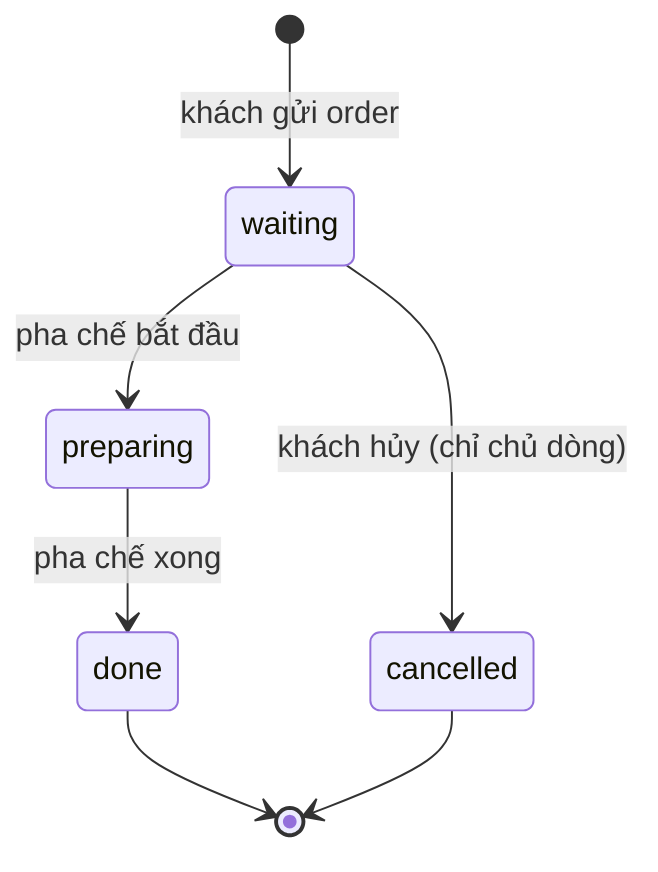
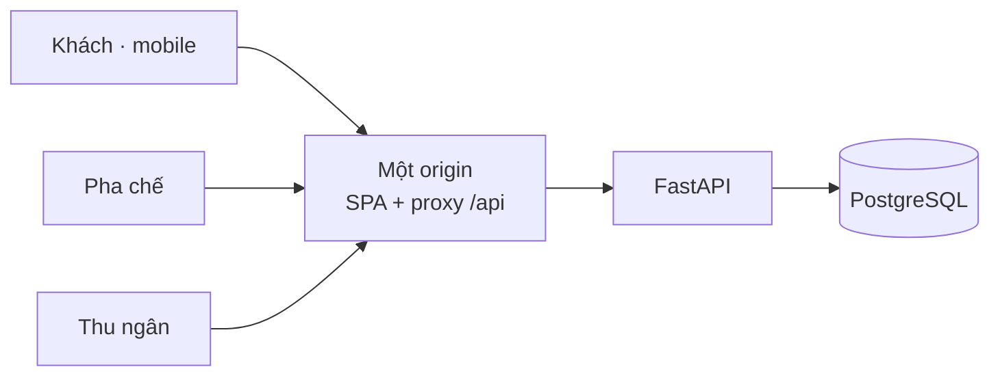
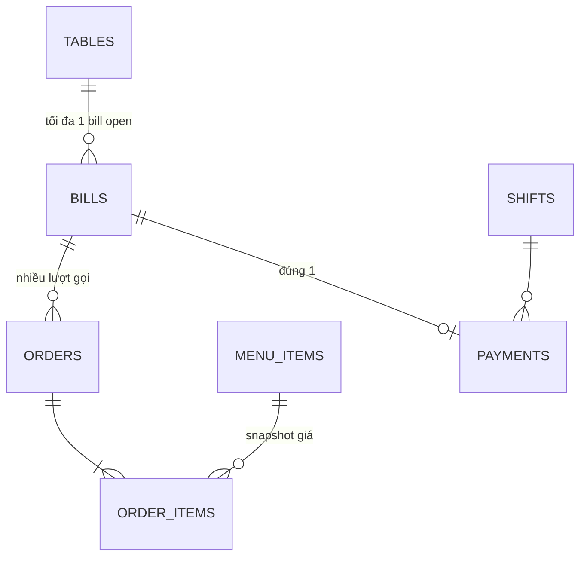

# TapOrder — kịch bản pitch 5 phút + Q&A 5 phút

Đề 2. Tối đa 8 slide. Quá giờ BTC dừng, nên bấm giờ thật khi tập.

Phân bổ theo đề: 1 phút vấn đề · 2 phút quy trình thiết kế · 3 phút demo · 1 phút
bài học AI · 5 phút hỏi đáp. Tổng nói là 7 phút nhưng đề cho 5 phút pitch **và**
demo — nên cắt: slide 1 (45 giây), slide 2–4 (90 giây), demo (150 giây),
slide 8 (45 giây). Ai nói phần nào thì người đó trả lời câu hỏi phần đó.

---

## Slide 1 — Vấn đề và người dùng (45 giây)

**Quán cà phê gần trường, giờ cao điểm.** Nhân viên ghi order bằng tay nên nhầm
món, quầy pha chế không biết làm cái nào trước, thu ngân khó đối soát hóa đơn
theo bàn.

Ba người dùng, ba nhu cầu khác nhau:

| Ai | Cần gì | Không cần gì |
| --- | --- | --- |
| Khách | Gọi món từ bàn mình, thấy món tới đâu | Không cần đăng nhập, không cần app |
| Pha chế | Biết thứ tự phải làm | Không cần thấy giá, không cần thanh toán |
| Thu ngân | Tổng đúng theo bàn, đóng bàn | Không cần đổi trạng thái món |

Khác biệt của nhóm: **khách không đăng nhập mà vẫn phải phân quyền được**. QR của
bàn là danh tính duy nhất, nên mọi quyết định thiết kế xoay quanh câu hỏi "ai được
làm gì trên hóa đơn này".

---

## Slide 2 — Sơ đồ trạng thái (35 giây)

Trạng thái nằm trên **từng dòng món**, không phải trên cả order. Đó là lý do một
bàn vừa có món đã xong vừa có món đang pha.

Bill: `open → paid`. `paid` là trạng thái cuối, không mở lại.

Chốt chặn: chỉ thu tiền được khi **mọi dòng chưa hủy** đã `done`. Dòng `cancelled`
vẫn lưu nhưng không tính tiền.

---

## Slide 3 — Kiến trúc và lý do (35 giây)

| Chọn | Vì sao |
| --- | --- |
| Modular monolith, một origin | Ba UI dùng chung cookie và CSRF; tách origin là thêm lỗi chứ không thêm giá trị trong 2 giờ |
| PostgreSQL | Tiền và trạng thái cần transaction và lock thật; SQLite không có lock hàng đủ cho đua giữa khách hủy và pha chế |
| Không Redis, không queue | Một quán, vài chục bàn. Thêm hạ tầng là thêm chỗ chết trong demo |
| React + TypeScript + Vite | Ba UI khác nhau nhưng chung một API client và một bộ type |

---

## Slide 4 — ERD và hai quyết định nghiệp vụ khó nhất (40 giây)

`order_items` giữ **snapshot tên và giá** lúc order được nhận, nên đổi giá menu
sau đó không làm hóa đơn cũ sai.

**Quyết định 1 — mở lại QR sau khi đã thanh toán thì làm gì?** Chọn: vào menu cho
lượt mới, và `GET` **không** tạo hóa đơn. Hóa đơn chỉ sinh ở lần gửi món hợp lệ
đầu tiên. Lý do: khách quét QR xem giá rồi đi là chuyện thường, nếu tạo bill ở
bước quét thì cuối ca thu ngân ngồi với một đống hóa đơn rỗng. Tab cũ của khách
thành biên nhận chỉ đọc, phải bấm "Bắt đầu lượt mới" mới vào lượt mới.

**Quyết định 2 — một món hết hàng khi khách đang chọn?** Chọn: **cả lượt gửi thất
bại** với `ITEM_UNAVAILABLE` kèm tên món, giỏ giữ nguyên để khách sửa. Lý do: nhận
một phần âm thầm là cách nhanh nhất để khách tưởng đã gọi 3 món mà quầy chỉ làm 2.
Thà một lần báo rõ hơn một lần tranh cãi ở quầy.

**Quyết định 3 (nếu còn thời gian) — khách hủy món đến khi nào?** Chỉ khi còn
`waiting`, và chỉ dòng do chính phiên khách đó gọi. Vào `preparing` là nguyên
liệu đã dùng; cho hủy tiếp là quán chịu lỗ. Bàn chung nên không ai hủy được món
của người khác.

---

## Slide 5 — Demo trực tiếp (150 giây)

Chạy trên luồng thật, không dữ liệu cứng. Hai cửa sổ khách + hai màn nhân viên.

**Link demo**: `https://leader-weighted-africa-carroll.trycloudflare.com`
(`/t/t1`, `/t/t3`, `/staff/login`). Tài khoản `cashier.demo` và `barista.demo`.
URL quick tunnel là tạm — nếu tunnel chết giữa demo, URL đổi, phải lấy lại.

Mở sẵn đủ 4 tab **trước khi lên sân khấu**, và mở ca trước, để 150 giây chỉ dùng
để bấm chứ không dùng để đăng nhập.

| # | Thao tác | Hội đồng phải thấy |
| --- | --- | --- |
| 1 | Thu ngân mở ca | Chưa mở ca thì khách gửi order bị chặn — chứng minh ràng buộc ở server |
| 2 | Bàn 1 gọi 2 cà phê sữa, ghi chú "Ít đá" | 60.000, tổng do server tính |
| 3 | Bàn 3 gọi 1 trà đào | 35.000, bàn 3 không thấy hóa đơn bàn 1 |
| 4 | Màn pha chế | Đủ hai bàn, đúng thứ tự FIFO, **không có giá** |
| 5 | Chờ → đang pha → xong | Màn khách bàn 1 tự đổi trạng thái |
| 6 | Thu ngân | Bàn 1 bật nút thu tiền, bàn 3 chỉ xem được — vì bàn 3 còn món chưa xong |
| 7 | Thu tiền bàn 1 | Bill `paid`, bàn về trống, đúng một payment |
| 8 | Mở lại QR bàn 1 | Vào menu lượt mới, hóa đơn cũ không đổi — quyết định 1 |
| 9 | Pha chế tắt một món, khách gửi món đó | Cả lượt bị chặn kèm tên món, giỏ còn nguyên — quyết định 2 |

Nói trước khi bấm: "đây là hai cửa sổ độc lập, không phải một trang đổi tab."

Nếu một bước fail: nói ngay đang xem gì và đi tiếp bước sau, đừng debug trên sân khấu.

---

## Slide 6 — Tính năng sáng tạo (trong 150 giây demo)

1. **Trạng thái món cập nhật về máy khách** mà khách không phải bấm làm mới, kèm
   badge nói rõ dữ liệu mới bao lâu — mất mạng thì badge chuyển vàng thay vì giả
   vờ vẫn đúng. Đây là lựa chọn có chủ ý: thà nói "đang chậm 12 giây" hơn là hiện
   số cũ như thật.
2. **Gợi ý món theo giờ quán**: 6–11h cà phê, 11–17h trà, còn lại nhóm khác, bù
   bằng món bán chạy. Có ghi lý do gợi ý, và **không tự thêm vào giỏ**.
3. **QR từng bàn xuất được PNG để in**, có SVG dự phòng khi trình duyệt không
   xuất được PNG.

---

## Slide 7 — Trạng thái thật của sản phẩm (30 giây, slide trung thực)

Đưa slide này vào chính là điểm cộng ở tiêu chí "phân tích nghiệp vụ" — và tránh
bị hỏi bẻ ở Q&A.

| Phần | Trạng thái |
| --- | --- |
| Ba giao diện, 9 route, các quy tắc nghiệp vụ | Chạy được |
| Backend | Có thật trong repo: `backend/app` (FastAPI, domain, services, security, seed), `backend/alembic` migration, `docker-compose.yml` cho PostgreSQL |
| Contract | `contracts/openapi.yaml` có, kèm `examples/` và `generated/` |
| Frontend mặc định | `VITE_USE_MOCK=0` — tức chạy **live** sang FastAPI, mock chỉ là đường dự phòng |
| Test | `backend/tests` có unit, integration và contract; `frontend` có Vitest + MSW ở nhánh `claude/frontend-polish-795da0` (81 test) chưa merge |
| Demo đang chạy | Cloudflare quick tunnel, URL tạm, máy nhóm tự host |

Nói thẳng điều này nếu bị hỏi: quy tắc nghiệp vụ được cưỡng chế ở server và DB,
không phải ẩn ở UI. Và nói rõ phần nào nhóm **đã tự chạy** so với phần nào chỉ có
trong repo — đừng nói "test pass" cho bộ test chưa bấm chạy trước mặt hội đồng.

---

## Slide 8 — Bài học dùng AI (45 giây)

- **AI giúp**: dựng 3 UI và toàn bộ luồng trong thời gian ngắn; viết sẵn tài liệu
  nối frontend–backend để hai người làm song song không phải đoán.
- **Nhóm bác bỏ đề xuất của AI**: AI đề xuất seed 6 bàn và menu 8 món cho đẹp —
  nhóm cắt về **đúng 2 bàn và 12 món** theo đặc tả, vì demo cần khớp đề chứ không
  cần nhiều bàn.
- **Nhóm sửa lỗi AI tự gây ra**: bản đầu refresh trang là mất đăng nhập nhân viên;
  phát hiện khi chạy thử thật, không phải khi đọc code.
- **Chỗ AI dễ nói quá**: AI mô tả "đã deploy" khi thực tế chỉ có server local.
  Nhóm bắt buộc mọi khẳng định phải có lệnh đã chạy hoặc lần bấm đã thấy — slide 7
  là kết quả của luật đó.
- **Chia việc để AI không chạm nhau**: contract `contracts/openapi.yaml` viết trước,
  frontend và backend làm song song trên nhánh riêng, nối lại bằng
  `docs/frontend-backend-integration.md`. Không có bước này thì hai bên đoán nhau
  và sửa cùng file.

---

## Chuẩn bị Q&A — câu hỏi dễ bị hỏi và trả lời thật

| Câu hỏi | Trả lời |
| --- | --- |
| Quyết định khó nhất? | Mở lại QR sau thanh toán. Hai phương án đều hợp lý; chọn theo cái gây ít rác dữ liệu hơn cho thu ngân |
| Hai khách cùng bàn, ai hủy được món nào? | Chỉ dòng mình gọi, và chỉ khi còn `waiting`. Toàn bill ai cũng xem được vì cùng ngồi một bàn |
| Hai người cùng gửi order một bàn cùng lúc? | Một bàn chỉ một bill `open`; hai lượt gộp vào cùng bill đó, không tạo hai hóa đơn |
| Ai cũng quét được QR bàn thì sao? | QR là capability, chấp nhận rủi ro ở quy mô một quán. Không cho đọc hóa đơn chỉ bằng số bàn, và hóa đơn đã thanh toán không mở lại được |
| Pha chế thấy giá không? | Không. Dữ liệu trả về cho màn pha chế không có giá và không có payment, chặn ở server chứ không phải ẩn ở UI |
| Thu tiền hai lần thì sao? | Lần hai trả `BILL_CLOSED`, trong DB vẫn đúng một payment |
| Sao không dùng SQLite cho nhanh? | Tiền và trạng thái cần lock hàng và transaction thật khi khách hủy đúng lúc pha chế bắt đầu |
| Đã test chưa? | Có `backend/tests` (unit, integration, contract) và 81 test frontend ở nhánh chưa merge. Nói rõ cái nào nhóm đã tự chạy; phần chưa chạy thì nói chưa chạy |
| Deploy chưa? | Chưa deploy theo nghĩa hạ tầng riêng. Đang chạy qua Cloudflare quick tunnel trỏ về máy nhóm: URL tạm, không backup, không rollback. Runbook cho bản thật ở `docs/deploy-frontend-public-backend-local.md` |
| Frontend có gọi backend thật không? | Có. `VITE_USE_MOCK=0` là mặc định; mock chỉ là đường dự phòng khi backend chưa chạy |
| Contract ở đâu? | `contracts/openapi.yaml`, có `examples/` và `generated/`; `backend/tests/contract` kiểm OpenAPI khớp examples |

Nguyên tắc Q&A: không nói "đã chạy" cho thứ chưa chạy. Hội đồng trừ điểm vì nói
quá nhiều hơn là vì thiếu tính năng.

---

## Nguồn

Quyết định nghiệp vụ D01–D11, kiến trúc, ERD và endpoint: [plans/product-plan.md](../plans/product-plan.md).
Kịch bản demo: [DEMO.txt](../DEMO.txt). Cách nối backend: [docs/frontend-backend-integration.md](frontend-backend-integration.md).
