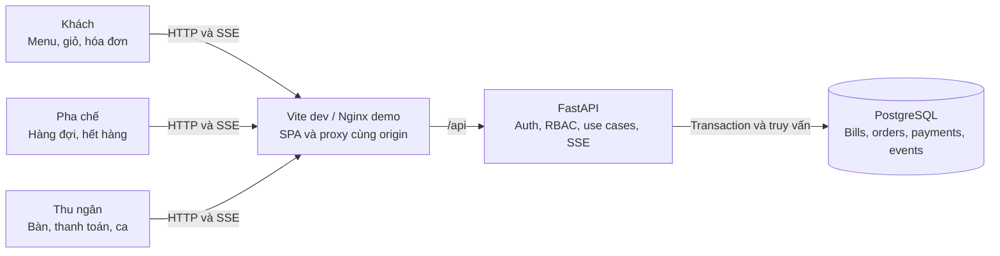
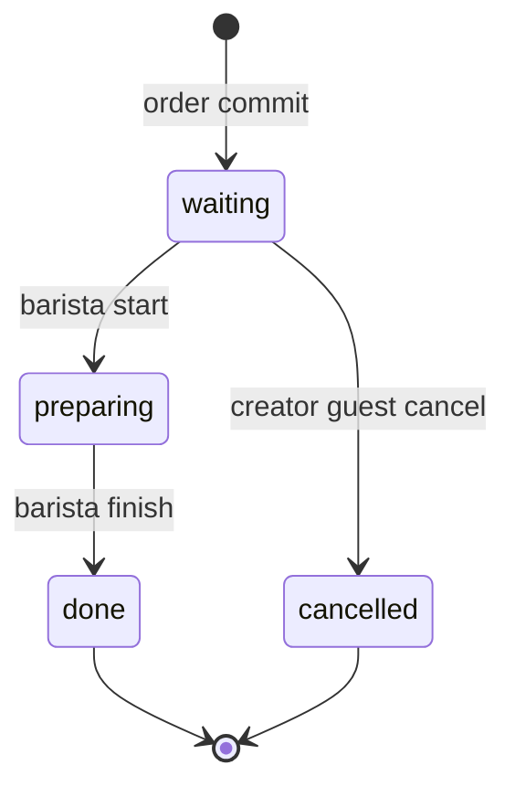

# TapOrder — PLAN chung frontend, backend và hệ thống

Ngày quyết định: 2026-11-03, Asia/Bangkok. Revision: PLAN-1, checkpoint S1 (hệ thống và nghiệp vụ); còn phần đặc tả FE/BE, contract, task graph và verification ở S2. Đây là kế hoạch, chưa phải bằng chứng phần mềm đã chạy hay contract đã được triển khai. Phạm vi lượt giao hiện tại: hoàn thành PLAN; chưa scaffold, chưa khởi chạy hai agent sản phẩm, chưa deploy.

Nguồn: yêu cầu Đề 2 TapOrder và bổ sung phân quyền của chủ repo trong chat; [agent guide](../agent.md), [template PLAN](product-plan.template.md), [playbook index](../playbook/README.md), [feature template](../docs/templates/feature-design.md). Đã đọc toàn bộ 10 Markdown trong playbook. Quy tắc repo hiện hành được ưu tiên hơn checkpoint cũ và ví dụ banking.

## 1. Bài toán, thuật ngữ và kết quả cần đạt

Quán cà phê cần thay ghi order tay bằng luồng QR đúng bàn → gửi món → pha chế theo thứ tự → thu tiền đúng hóa đơn. Có ba vai trò nghiệp vụ: khách hàng, pha chế, thu ngân. Khách không đăng nhập; hai vai trò nhân viên phải đăng nhập và có quyền khác nhau ở API lẫn UI.

| Thuật ngữ | Nghĩa duy nhất trong toàn bộ sản phẩm |
| --- | --- |
| Bàn / table | Vị trí vật lý, có mã số hiển thị và QR riêng ổn định |
| Phiên bàn / bill | Một hóa đơn cho một lượt phục vụ; `open` hoặc `paid`; không đồng nhất với browser session |
| Lượt gọi / order | Một lần gửi giỏ đã được server chấp nhận, thuộc một bill |
| Dòng món / order item | Một món + số lượng + ghi chú trong một lượt gọi; trạng thái áp dụng cho toàn dòng |
| Phiên khách / guest session | Danh tính ẩn danh bằng cookie, chứa quyền đối với các bill đã tham gia |
| Trạng thái món | `waiting` (chờ), `preparing` (đang pha), `done` (xong), `cancelled` (đã hủy) |
| Ca / shift | Khoảng thời gian thu ngân mở và đóng; doanh thu tính theo payment được xác nhận trong ca |
| Thanh toán | Thu ngân xác nhận đã thu tiền mặt; không có cổng thanh toán trực tuyến |

Tiêu chí thành công: hai browser độc lập gửi bàn 1 và bàn 3; pha chế nhìn thấy đủ hai lượt, đổi trạng thái một món; khách đúng bàn thấy cập nhật; thu ngân đóng bàn 1 đúng tổng; QR bàn 1 dùng được cho lượt mới mà không sửa bill đã trả tiền. Không rò dữ liệu bàn khác, không nhân đôi order/payment khi retry, không nhận thêm món vào bill đã đóng.

## 2. Phạm vi, quyết định nghiệp vụ và ưu tiên

### 2.1 Phạm vi

- P0: QR từng bàn; menu; giỏ, ghi chú, gọi thêm; ba vai trò và ba UI; hàng đợi pha chế; hóa đơn theo bàn; xác nhận tiền mặt và đóng bàn; hết hàng; hủy khi chờ; seed/demo; kiểm thử critical flows.
- P1 bắt buộc trong bản demo mục tiêu: cập nhật thời gian thực bằng SSE và phục hồi bằng polling. SSE là phương án tương đương WebSocket phù hợp dữ liệu chủ yếu server → browser.
- P2 làm sau khi P0/P1 đạt: gợi ý theo giờ/bán chạy, thống kê ca. Có thiết kế trong PLAN để không thêm schema tùy hứng; nếu thiếu thời gian, demo sáng tạo dùng P1, không tuyên bố P2 đã chạy.
- Ngoài scope: nhiều chi nhánh, đặt bàn, giao hàng, thanh toán gateway, chia/gộp/chuyển bàn, chia bill, hoàn tiền, sửa giá/menu CRUD, quản lý kho nguyên liệu, in hóa đơn phần cứng, tài khoản khách, quản trị user qua UI, mobile native, AI trả phí.
- Một quán, một ca đang mở; tiền VND không thuế/phụ phí/giảm giá trong MVP. Món được seed cố định, có thể bật/tắt còn hàng; số lượng tồn không được quản lý. Không suy ra nghiệp vụ ngân hàng từ playbook.

### 2.2 Quyết định nhóm phải trình bày

| ID | Quyết định | Lý do và hệ quả FE/BE |
| --- | --- | --- |
| D01 | Khách hủy toàn dòng do chính phiên khách tạo, chỉ khi `waiting`; không hủy một phần số lượng | Tránh khách bàn chung hủy đồ của người khác. `preparing/done` trả 409; khóa DB giải quyết race với pha chế |
| D02 | QR sau thanh toán vào menu cho lượt mới; GET không tạo bill. Chỉ lần submit đầu hợp lệ mới tạo bill `open` | Tránh hóa đơn rỗng do quét QR. Bill cũ giữ nguyên; tab cũ xem biên nhận và phải bấm “Bắt đầu lượt mới” để tham gia bill mới |
| D03 | Một món hết hàng làm toàn lượt gửi thất bại với 409 `ITEM_UNAVAILABLE` và danh sách món | Không nhận một phần âm thầm; giỏ và ghi chú giữ nguyên; khách sửa rồi gửi với key mới |
| D04 | Giá hiện tại khác giá khách thấy: toàn lượt trả 409 `PRICE_CHANGED`; khách xác nhận lại | Server tính tiền; mỗi dòng giữ snapshot giá/tên lúc order được chấp nhận |
| D05 | Một bàn tối đa một bill `open`; nhiều lượt gọi gộp đúng bill; nhiều khách có thể tham gia cùng bill | Guest chỉ nhìn bill đã tham gia, toàn bill xem được nhưng chỉ dòng của mình có nút hủy |
| D06 | Chỉ thanh toán khi tất cả dòng không hủy đã `done`; bill toàn dòng hủy được đóng với tổng 0 | Tránh đóng bàn khi quầy còn làm. Cần ít nhất một order đã tồn tại; không tạo bill rỗng để thu tiền |
| D07 | Tiền mặt một lần, không hoàn/mở lại bill `paid`; lưu payment duy nhất/bill kể cả tổng 0 | Đối soát đơn giản, retry không thu hai lần; sửa sai ngoài scope, phải thể hiện rõ ở demo |
| D08 | FIFO theo `order.created_at`, tie-break ID; gọi thêm giữ thứ tự của lượt gọi thêm | Không để bàn cũ gọi thêm chen lên trước; queue không dựa vào thời gian client |
| D09 | Pha chế bật/tắt hết hàng; thu ngân xem nhưng không đổi trạng thái pha chế | Phân quyền thực dụng, không thêm vai trò admin sản phẩm |
| D10 | Mở lại QR không chứng minh người đang ngồi thực tế; QR là capability để yêu cầu tham gia bàn | Demo chấp nhận rủi ro QR bị chia sẻ. URL ngẫu nhiên, rate limit, không cho đọc bill chỉ bằng số bàn; production cần kiểm soát tại quán nếu mở Internet |
| D11 | Ca bắt buộc để nhận order/thanh toán; thu ngân mở ca đầu demo; đóng ca chỉ khi không còn bill mở | Payment gắn ca lúc thu tiền; không có bill mở chạy qua ca trong MVP |

Không còn câu hỏi nghiệp vụ chặn PLAN. Đây là quyết định thiết kế của nhóm trong phạm vi đề cho tự quyết; thay đổi sau này phải cập nhật revision/contract/tests trước khi code. Exact dependency versions, CI branch protection thực tế và đích deploy chỉ chốt ở task tương ứng, không giả định đã tồn tại.

## 3. Thiết kế hệ thống tổng thể — trước thiết kế tính năng

### 3.1 Kiến trúc và ranh giới

Modular monolith: React SPA dùng chung API client → FastAPI → SQLAlchemy/services → PostgreSQL. PostgreSQL là nguồn chuẩn dữ liệu, trạng thái, tiền, quyền, sự kiện. Một API worker cho demo, không Redis/queue/microservices. SSE chỉ báo dữ liệu cần refetch; snapshot HTTP là nguồn chuẩn khi mất kết nối.

Mũi tên chỉ quan hệ request/data, không phải luồng thao tác. Không có tích hợp ngoài bắt buộc; QR sinh local, SSE và báo cáo không phụ thuộc dịch vụ bên thứ ba. Chuyển nhiều API worker là thay đổi kiến trúc sau MVP, phải đo lại fan-out/connection pool/rate limits.

### 3.2 Stack và môi trường

| Thành phần | Quyết định | Gate xác minh khi scaffold |
| --- | --- | --- |
| FE | React, TypeScript, Vite, Tailwind, shadcn/ui/Radix; TanStack Router/Query/Table; RHF + Zod; Zustand chỉ cho giỏ/UI | Kiểm tra upstream `satnaing/shadcn-admin`, MIT; giữ LICENSE/README upstream; bỏ UI mẫu không liên quan |
| BE | Python, FastAPI/Uvicorn, SQLAlchemy 2, psycopg 3, Alembic, Pydantic; Argon2 cho password | Khóa bản tương thích thực tế, không copy các version banking thành sự thật repo |
| Package manager | npm + `package-lock.json`; uv + `uv.lock`; pin Python/Node runtime, Docker images/digests | `npm ci`, `uv sync --frozen` trên môi trường sạch; ghi exact versions vào README và locks |
| Test | Vitest + Testing Library + MSW; pytest/httpx + PostgreSQL; Playwright cho demo critical E2E | Chỉ thêm dependency phục vụ test đã nêu; browser test nằm task integration |
| Dev | FE `127.0.0.1:5173`, API `127.0.0.1:8000`, DB dev `127.0.0.1:5432` | Vite proxy `/api`; FE không gọi DB; API docs local |
| Demo compose | Nginx UI `127.0.0.1:8080`, API/DB nội bộ mạng Compose, named volume dev/demo | `/api` giữ cookie/Origin, tắt proxy buffering cho SSE; migrate job xong trước API ready |
| Test | Compose project/DB riêng, DB test cổng 5433 nếu cần host access | Refuse chạy integration khi DSN trỏ DB dev; không xóa volume dev |
| Config | `.env.example` chỉ placeholder, `.env` ignored; DB URL, session secret, allowed origins, demo timezone, seed passwords | Fail startup nếu thiếu secret bắt buộc; không in password/token vào logs/context |

Dev/demo HTTP localhost cho phép cookie không Secure theo cấu hình rõ ràng; môi trường HTTPS phải Secure. Đề không yêu cầu public deployment: LAN/điện thoại thật hoặc Internet cần task riêng cấu hình origin, TLS, firewall và QR base URL. Demo bắt buộc dùng hai browser trên máy demo là đủ.

### 3.3 Chất lượng và vận hành mục tiêu

Đây là ngân sách nghiệm thu, chưa phải kết quả benchmark: 20 bàn, 50 khách đang mở trang, tối đa 5 màn nhân viên; menu 100 món; 1.000 order/ca. API thông thường p95 <= 500 ms, submit/thanh toán p95 <= 1 giây, trạng thái tới khách <= 2 giây khi SSE tốt; polling tối đa 5 giây sau mất stream. Đo trên máy demo, ghi cấu hình và workload; nếu không đo thì ghi “chưa đo”.

Health `/api/health/live` chỉ liveness; `/api/health/ready` kiểm DB/schema. Timeout DB transaction 5 giây, trả 503 có request ID khi không phục hồi. SSE heartbeat 15 giây, disconnect không đổi state, reconnect backoff 1/2/4/8/15 giây có jitter. Log JSON request ID, endpoint, actor ID ẩn danh/staff ID, latency, error code; audit các mutation. Không log cookie, CSRF, QR token, password hoặc nội dung ghi chú khách. Mục tiêu UI khách mobile từ 360 px; staff dùng tablet/desktop từ 768 px, có phương án cuộn hợp lý trên mobile.

## 4. Danh tính, phân quyền và ba giao diện

### 4.1 Nguồn quyền và phiên

- `guest`: tạo ẩn danh khi bootstrap, cookie HttpOnly riêng; không username/password. QR chứa token ngẫu nhiên tối thiểu 128 bit, DB chỉ lưu hash. Endpoint join xác minh token và cấp membership cho bill mở; khách không được tự đặt role hay table ID để lấy quyền.
- `barista`, `cashier`: user seed riêng với password băm Argon2, role từ DB; không cho đổi role trong UI, không tin role từ request. Không thêm admin UI. Tài khoản demo lấy từ biến môi trường ignored, không commit mật khẩu.
- Staff session opaque token hash trong DB, hết hạn 8 giờ tuyệt đối; guest session 12 giờ tuyệt đối. Membership bill tồn tại để xem biên nhận trong hạn session; session mới không được xem bill `paid` cũ qua QR. Hết session khách được join lại bill đang mở bằng QR, nhưng không nhận quyền hủy dòng của guest cũ; staff hỗ trợ theo quy trình quán, không nới quyền API.
- Hai cookie độc lập cho guest và staff để tab khách/staff trong cùng browser không ghi đè nhau. Một request xét đúng loại principal theo endpoint; staff không tự động thừa hưởng quyền guest. Cookie SameSite=Lax, Path=/, HttpOnly; Secure khi HTTPS. CSRF token riêng từng principal lấy qua bootstrap/session, giữ trong memory; mutation bắt `X-CSRF-Token` và exact allowlisted Origin, trừ health/read-only.
- Session cookie không lưu trong localStorage; logout/hết hạn xóa cache staff, đóng SSE; guest cache có key scope guest/bill. Không trộn cache khi chuyển role. IDOR test cho mọi resource: guest truy cập bill/item bàn khác trả 404; staff sai role trả 403, chưa đăng nhập trả 401.

### 4.2 Ma trận quyền backend và UI

| Chức năng/thao tác | Khách hàng | Pha chế | Thu ngân |
| --- | --- | --- | --- |
| Mở QR/menu | Bàn có QR hợp lệ; xem giá/còn hàng | Không phải thao tác staff; dùng route guest riêng nếu cần | Tương tự |
| Tạo/join bill | Dùng capability QR; chỉ bill mở của bàn đó | Cấm | Cấm tạo order thay khách trong MVP |
| Gửi order/gọi thêm | Chỉ bill có membership, còn `open` | Cấm | Cấm |
| Xem món/trạng thái/tổng tạm | Toàn bill đã tham gia; không xem bàn khác | Dòng hoạt động mọi bàn: bàn, món, lượng, note, thời gian; không giá/payment | Bill mọi bàn, dòng món, giá và tổng |
| Hủy món | Chỉ dòng của mình đang `waiting`, bill mở | Cấm hủy hộ; chỉ đổi tiến độ | Cấm hủy/đổi món |
| Đổi trạng thái | Cấm | `waiting → preparing → done`, mọi bàn, bill mở | Cấm |
| Đổi còn hàng | Chỉ đọc | Bật/tắt `available`, có version chống ghi đè | Chỉ đọc |
| Xem danh sách bàn/QR | Chỉ tên bàn mình trong phiên | Tên bàn trên queue; không xuất token QR | Xem bảng bàn, in/xem QR; QR là capability không phát công khai |
| Xác nhận tiền mặt/đóng bill | Cấm | Cấm | Bill mở đủ điều kiện; expected total/version |
| Xem bill đã trả tiền | Bill đã tham gia, trong hạn guest session | Không xem lịch sử tài chính | Xem lịch sử/biên nhận mọi bill |
| Mở/đóng ca | Cấm | Chỉ đọc ca có mở để vận hành | Được; đóng khi không còn bill mở |
| Gợi ý | Còn hàng, theo menu/giờ | Không có màn gợi ý | Không sửa thuật toán qua UI |
| Thống kê doanh thu/bán chạy | Cấm | Cấm | Xem theo ca; chỉ payment đã xác nhận |
| Tạo user/đổi role/giá | Cấm | Cấm | Cấm; seed/config ngoài UI |

Mọi quyền được kiểm tại router dependency + service resource scope, gồm SSE và read APIs; không chỉ ẩn nút. Response DTO riêng tránh lộ giá/doanh thu cho pha chế, token/actor ID của người khác cho khách. Guest chỉ nhận `can_cancel` và nhãn “Của bạn”, không ID danh tính người khác.

### 4.3 UI riêng

| Vai trò | Landing/navigation | Thành phần chính | Hành vi bị chặn |
| --- | --- | --- | --- |
| Khách | `/t/:qrToken`, `/guest/bills/:billId` | Header bàn nổi bật, danh mục món, card giá/còn hàng, nút giỏ, form note, danh sách lượt gọi, trạng thái dạng chữ, tổng tạm, biên nhận | Không sidebar nhân viên, không bảng bàn khác, không nút đổi tiến độ/thu tiền; link staff đưa tới login |
| Pha chế | `/staff/kitchen`, `/staff/availability` | Hàng đợi FIFO, lọc chờ/đang pha/bàn, tuổi order, món/lượng/note lớn, hai nút bắt đầu/xong theo state; màn bật/tắt còn hàng | Không cột tiền, doanh thu, thanh toán hoặc menu cashier; route cashier bị guard và API 403 |
| Thu ngân | `/staff/tables`, `/staff/bills/:billId`, `/staff/shifts` | Grid bàn có trạng thái/tổng; bill nhiều lượt, dòng hủy ghi rõ; modal xác nhận số tiền; lịch sử; mở/đóng ca; QR; báo cáo P2 | Không nút làm món/hủy hộ/sửa giá; route kitchen bị guard và API 403 |

Sau login: server trả role, router chuyển đúng landing; truy cập route sai quyền hiện 403 với link quay lại màn được phép. Reload phải khôi phục session trước khi dựng màn, tránh ló nội dung sai role. Login pending khóa nút; 401 thông báo chung, 429 hiện thời gian thử lại. Keyboard focus, label rõ, vùng bấm >= 44 px; không dùng màu làm dấu hiệu duy nhất.

## 5. Dữ liệu, bất biến và đồng thời

### 5.1 Data model dự kiến cho migration

Tất cả ID UUID server tạo; thời gian `timestamptz` UTC, hiển thị Asia/Bangkok; tiền integer VND trong BIGINT, API chuỗi chữ số. Cột mặc định NOT NULL trừ đánh dấu `?`. `version` integer bắt đầu 1 tăng sau mỗi mutation đối tượng. Không hard-delete bill/order/payment/audit; FK nghiệp vụ RESTRICT. Schema cột chi tiết cuối cùng được viết tại bước detailed design trước migration.

| Bảng | Cột và constraint cốt lõi | Index/query |
| --- | --- | --- |
| tables | id PK, number int UNIQUE >0, label varchar(60), qr_token_hash UNIQUE, enabled bool default true, created_at | Token lookup, danh sách bàn theo number |
| staff_users | id, username varchar(80) UNIQUE, password_hash, role enum barista/cashier, active bool | Login username |
| sessions | id, token_hash UNIQUE, kind guest/staff, staff_user_id? FK, csrf_hash, expires_at, revoked_at?, created_at; CHECK kind/staff FK tương ứng | Token; expiry cleanup; guest ID dùng session.id |
| shifts | id, status open/closed, opened_by FK staff, opened_at, closed_by?, closed_at?, version; chỉ 1 open qua partial unique index | Ca hiện tại; closed_at |
| bills | id, table_id FK, shift_id FK, status open/paid, version, opened_at, paid_at?, total_vnd?; CHECK paid có paid_at/total | Partial UNIQUE table_id WHERE status=open; table/time, shift/status |
| bill_memberships | bill_id FK + guest_session_id FK composite PK, joined_at | Scope lookup theo guest/bill |
| menu_categories | id, name varchar(80), sort_order int | Thứ tự menu |
| menu_items | id, category_id FK, name varchar(120), description varchar(500), price_vnd BIGINT >0 <=10000000, available bool, active bool, version | Category/active/sort; seed menu |
| orders | id, bill_id FK, created_by_session_id FK, created_at, order_number BIGINT generated UNIQUE | bill/created_at; queue created_at/id |
| order_items | id, order_id FK, menu_item_id FK, name_snapshot, unit_price_vnd BIGINT >0, quantity int 1..20, note varchar(250), status enum, version, started_at?, done_at?, cancelled_at? | order_id; status/order_id; snapshot và time checks |
| payments | id, bill_id FK UNIQUE, shift_id FK, cashier_id FK, method=cash, amount_vnd BIGINT >=0, paid_at | shift/paid_at, bill UNIQUE |
| idempotency_records | id, principal_kind/id, operation, key UUID, payload_hash, response_status, response_json, created_at, expires_at; UNIQUE scope/operation/key | Retry lookup; giữ tối thiểu 24 giờ |
| domain_events | id BIGINT generated PK, bill_id? FK, audience guest/kitchen/cashier/menu, event_type, aggregate_version, created_at | audience/id; bill_id/id, retention 24 giờ |
| audit_events | id, request_id, principal_kind/id, action, resource_type/id, before_state?, after_state?, created_at | resource/time; không chứa secrets/note text |

Bill total mở tính server SUM(unit_price_snapshot * quantity) với status != cancelled, không lấy tổng từ client; closed bill lưu snapshot và đối soát payment cùng transaction. Line max 200.000.000 VND; tối đa 50 dòng/lượt và tổng bill <= 1.000.000.000 VND, vượt trả 422 `BILL_LIMIT_EXCEEDED`. Note được trim, text thuần, không HTML; quantity là integer, không nhận float/0/số âm. Không gộp các dòng khác ghi chú; cùng món/note có thể là dòng riêng.

### 5.2 State và bất biến

`waiting → preparing → done` là đường duy nhất của pha chế; không quay lùi/nhảy bước. `paid` là terminal của bill; payment không thay state món. `can_pay` chỉ true nếu mọi dòng `done/cancelled` và ca mở. Table UI: rảnh khi không có bill mở, phục vụ khi có bill mở, sẵn sàng thanh toán khi can_pay; không lưu thêm trạng thái table dễ lệch.

Bất biến phải bảo vệ bằng DB + service: một bill mở/bàn; một payment/bill; một order/mutation thành công cho một idempotency key; snapshot giá bất biến; cancelled không tính tiền; role/scope đúng ở cả read/write/stream; sự kiện và audit chỉ tồn tại cùng transaction đã commit; lỗi trước commit không để lại bill/order/payment dở dang.

### 5.3 Transaction/lock và race

Thứ tự khóa toàn cục cho mutation: idempotency reservation → ca hiện tại → table → bill → menu_items theo UUID tăng dần → order_items theo UUID tăng dần. Chỉ lấy các khóa cần thiết nhưng không đảo thứ tự. Ca dùng shared row lock cho order/payment, exclusive cho open/close; table/bill dùng `FOR UPDATE`. READ COMMITTED với truy vấn kiểm tra lại sau khi đã khóa. Ca đóng kiểm bill mở dưới exclusive lock nên không đua tạo bill.

| Race | Quy tắc và hậu điều kiện |
| --- | --- |
| Hai submit đầu cùng bàn | Cùng khóa table; giao dịch sau join bill mới tạo; partial unique index là hàng rào cuối; 1 bill/2 order |
| Submit gọi thêm và thanh toán | Cùng table/bill lock. Submit trước làm tăng version và có món chờ nên payment từ snapshot cũ 409; payment trước thì submit bill cũ 409 `BILL_CLOSED`, không tự chuyển sang bill mới |
| Hủy và pha chế bắt đầu | Khóa bill rồi item, kiểm expected_version/state; một thắng, một 409; không có dòng vừa cancelled vừa preparing |
| Hết hàng và submit | Submit khóa menu row, availability update cũng khóa menu row; quyết định theo trạng thái commit được serialize, không nhận order nếu hết hàng đã commit trước |
| Hai thu ngân thanh toán | Khóa bill + UNIQUE payment; một thành công; key cũ replay, key khác 409 BILL_CLOSED; không nhân đôi payment |
| Mất mạng sau commit | Retry cùng key và cùng payload trả response cũ trước kiểm tra state mới; chỉ replay sau khi xác thực quyền phù hợp; payload khác 409 IDEMPOTENCY_CONFLICT |

Idempotency áp dụng submit, cancel, status, availability, payment, open/close shift. Scope theo principal + operation + key; transaction INSERT unique reservation, khi concurrent trùng chờ kết quả rồi đọc bản committed. Rollback không lưu response thành công; 4xx không cache, retry chỉnh input dùng key mới. Sau 24 giờ key có thể hết hạn: FE không tự retry command cũ, phải đối soát snapshot/order history và yêu cầu thao tác mới. Lock timeout/deadlock rollback và trả 503 `RETRYABLE_CONFLICT`, client giữ key; tối đa 2 retry có backoff, sau đó báo chưa xác định và cho đối soát.

## 6. Seed, phục hồi và giới hạn triển khai

Seed idempotent: bàn 1..5, tối thiểu 3 danh mục/12 món (cà phê, trà, khác), hai user barista/cashier từ env. QR sinh cùng base URL đang chạy, không hardcode localhost cho deployment khác; raw token chỉ có trong output QR được quản lý tại máy demo, không commit. Seed không tự tạo payment/order giả ở mode demo; fixtures tests riêng để kết quả đối soát được. Mỗi lần demo thu ngân mở ca; dùng bill mới thay vì xóa dữ liệu.

Migration Alembic từ DB sạch → seed → health → login. Test nâng cấp từ revision liền trước khi có migration thứ hai; review SQL/destructive operations. Backup logical DB trước migration demo có dữ liệu; restore thử ở DB riêng trong rehearsal release nếu có thay schema. Rollback ưu tiên image/commit trước có schema tương thích; destructive migration không tự downgrade/xóa volume. Với migration phá tương thích phải có kế hoạch restore được phê duyệt trong task release. Dữ liệu order/payment giữ toàn bộ trong demo; events/idempotency dọn sau 24 giờ bằng maintenance command explicit, không tự xóa bill/audit. Guest/session hết hạn revoke và purge token theo job, audit vẫn giữ actor reference ẩn danh.

Phần tiếp theo ở checkpoint S2: contract, catalog/từng feature, routes/FE state, use cases BE, task graph, acceptance tests, CI/CD, integration và demo/handoff; tất cả nối tiếp trong file này.
