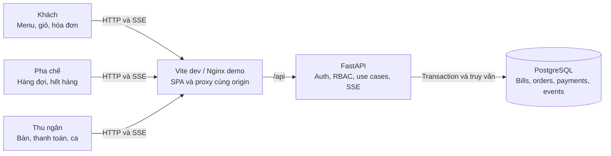
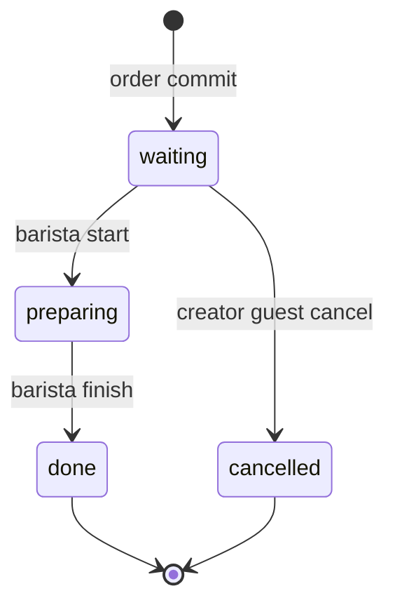
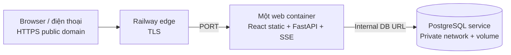

# TapOrder — PLAN chung frontend, backend và hệ thống

Ngày quyết định: 2026-11-03, Asia/Bangkok. Revision: PLAN-1, checkpoint nghiên cứu reuse/deploy sau S1; còn phần đặc tả FE/BE, contract, task graph và verification ở S2. Đây là kế hoạch, chưa phải bằng chứng phần mềm đã chạy. Phạm vi: hoàn thành PLAN và khảo sát/clone nguồn theo bổ sung của chủ repo; chưa scaffold sản phẩm, chưa chạy hai agent sản phẩm, chưa tạo tài nguyên cloud.

Hai ưu tiên bổ sung: **mục 7 — repo có sẵn và kế hoạch tinh chỉnh**, **mục 8 — thủ tục đưa webapp lên Internet**. Toàn bộ PLAN frontend/backend nằm chung file này; context chỉ ghi checkpoint.

Nguồn: yêu cầu Đề 2 TapOrder và bổ sung phân quyền của chủ repo trong chat; [agent guide](../agent.md), [template PLAN](product-plan.template.md), [playbook index](../playbook/README.md), [feature template](../docs/templates/feature-design.md). Đã đọc toàn bộ 10 Markdown trong playbook. Quy tắc repo hiện hành được ưu tiên hơn checkpoint cũ và ví dụ banking.

## 1. Bài toán, thuật ngữ và kết quả cần đạt

Quán cà phê cần thay ghi order tay bằng luồng QR đúng bàn → gửi món → pha chế theo thứ tự → thu tiền đúng hóa đơn. Có ba vai trò nghiệp vụ: khách hàng, pha chế, thu ngân. Khách không đăng nhập; hai vai trò nhân viên phải đăng nhập và có quyền khác nhau ở API lẫn UI.

| Thuật ngữ | Nghĩa duy nhất trong toàn bộ sản phẩm |
| --- | --- |
| Bàn / table | Vị trí vật lý, có mã số hiển thị và QR riêng ổn định |
| Phiên bàn / bill | Một hóa đơn cho một lượt phục vụ; `open` hoặc `paid`; không đồng nhất với browser session |
| Lượt gọi / order | Một lần gửi giỏ đã được server chấp nhận, thuộc một bill |
| Dòng món / order item | Một món + số lượng + ghi chú trong một lượt gọi; trạng thái áp dụng cho toàn dòng |
| Phiên khách / guest session | Danh tính ẩn danh bằng cookie, chứa quyền đối với các bill đã tham gia |
| Trạng thái món | `waiting` (chờ), `preparing` (đang pha), `done` (xong), `cancelled` (đã hủy) |
| Ca / shift | Khoảng thời gian thu ngân mở và đóng; doanh thu tính theo payment được xác nhận trong ca |
| Thanh toán | Thu ngân xác nhận đã thu tiền mặt; không có cổng thanh toán trực tuyến |

Tiêu chí thành công: hai browser độc lập gửi bàn 1 và bàn 3; pha chế nhìn thấy đủ hai lượt, đổi trạng thái một món; khách đúng bàn thấy cập nhật; thu ngân đóng bàn 1 đúng tổng; QR bàn 1 dùng được cho lượt mới mà không sửa bill đã trả tiền. Không rò dữ liệu bàn khác, không nhân đôi order/payment khi retry, không nhận thêm món vào bill đã đóng.

## 2. Phạm vi, quyết định nghiệp vụ và ưu tiên

### 2.1 Phạm vi

- P0: QR từng bàn; menu; giỏ, ghi chú, gọi thêm; ba vai trò và ba UI; hàng đợi pha chế; hóa đơn theo bàn; xác nhận tiền mặt và đóng bàn; hết hàng; hủy khi chờ; seed/demo; kiểm thử critical flows.
- P1 bắt buộc trong bản demo mục tiêu: cập nhật thời gian thực bằng SSE và phục hồi bằng polling. SSE là phương án tương đương WebSocket phù hợp dữ liệu chủ yếu server → browser.
- P2 làm sau khi P0/P1 đạt: gợi ý theo giờ/bán chạy, thống kê ca. Có thiết kế trong PLAN để không thêm schema tùy hứng; nếu thiếu thời gian, demo sáng tạo dùng P1, không tuyên bố P2 đã chạy.
- Ngoài scope: nhiều chi nhánh, đặt bàn, giao hàng, thanh toán gateway, chia/gộp/chuyển bàn, chia bill, hoàn tiền, sửa giá/menu CRUD, quản lý kho nguyên liệu, in hóa đơn phần cứng, tài khoản khách, quản trị user qua UI, mobile native, AI trả phí.
- Một quán, một ca đang mở; tiền VND không thuế/phụ phí/giảm giá trong MVP. Món được seed cố định, có thể bật/tắt còn hàng; số lượng tồn không được quản lý. Không suy ra nghiệp vụ ngân hàng từ playbook.

### 2.2 Quyết định nhóm phải trình bày

| ID | Quyết định | Lý do và hệ quả FE/BE |
| --- | --- | --- |
| D01 | Khách hủy toàn dòng do chính phiên khách tạo, chỉ khi `waiting`; không hủy một phần số lượng | Tránh khách bàn chung hủy đồ của người khác. `preparing/done` trả 409; khóa DB giải quyết race với pha chế |
| D02 | QR sau thanh toán vào menu cho lượt mới; GET không tạo bill. Chỉ lần submit đầu hợp lệ mới tạo bill `open` | Tránh hóa đơn rỗng do quét QR. Bill cũ giữ nguyên; tab cũ xem biên nhận và phải bấm “Bắt đầu lượt mới” để tham gia bill mới |
| D03 | Một món hết hàng làm toàn lượt gửi thất bại với 409 `ITEM_UNAVAILABLE` và danh sách món | Không nhận một phần âm thầm; giỏ và ghi chú giữ nguyên; khách sửa rồi gửi với key mới |
| D04 | Giá hiện tại khác giá khách thấy: toàn lượt trả 409 `PRICE_CHANGED`; khách xác nhận lại | Server tính tiền; mỗi dòng giữ snapshot giá/tên lúc order được chấp nhận |
| D05 | Một bàn tối đa một bill `open`; nhiều lượt gọi gộp đúng bill; nhiều khách có thể tham gia cùng bill | Guest chỉ nhìn bill đã tham gia, toàn bill xem được nhưng chỉ dòng của mình có nút hủy |
| D06 | Chỉ thanh toán khi tất cả dòng không hủy đã `done`; bill toàn dòng hủy được đóng với tổng 0 | Tránh đóng bàn khi quầy còn làm. Cần ít nhất một order đã tồn tại; không tạo bill rỗng để thu tiền |
| D07 | Tiền mặt một lần, không hoàn/mở lại bill `paid`; lưu payment duy nhất/bill kể cả tổng 0 | Đối soát đơn giản, retry không thu hai lần; sửa sai ngoài scope, phải thể hiện rõ ở demo |
| D08 | FIFO theo `order.created_at`, tie-break ID; gọi thêm giữ thứ tự của lượt gọi thêm | Không để bàn cũ gọi thêm chen lên trước; queue không dựa vào thời gian client |
| D09 | Pha chế bật/tắt hết hàng; thu ngân xem nhưng không đổi trạng thái pha chế | Phân quyền thực dụng, không thêm vai trò admin sản phẩm |
| D10 | Mở lại QR không chứng minh người đang ngồi thực tế; QR là capability để yêu cầu tham gia bàn | Demo chấp nhận rủi ro QR bị chia sẻ. URL ngẫu nhiên, rate limit, không cho đọc bill chỉ bằng số bàn; production cần kiểm soát tại quán nếu mở Internet |
| D11 | Ca bắt buộc để nhận order/thanh toán; thu ngân mở ca đầu demo; đóng ca chỉ khi không còn bill mở | Payment gắn ca lúc thu tiền; không có bill mở chạy qua ca trong MVP |

Không còn câu hỏi nghiệp vụ chặn PLAN. Đây là quyết định thiết kế của nhóm trong phạm vi đề cho tự quyết; thay đổi sau này phải cập nhật revision/contract/tests trước khi code. Exact dependency versions, CI branch protection thực tế và đích deploy chỉ chốt ở task tương ứng, không giả định đã tồn tại.

## 3. Thiết kế hệ thống tổng thể — trước thiết kế tính năng

### 3.1 Kiến trúc và ranh giới

Modular monolith: React SPA dùng chung API client → FastAPI → SQLAlchemy/services → PostgreSQL. PostgreSQL là nguồn chuẩn dữ liệu, trạng thái, tiền, quyền, sự kiện. Một API worker cho demo, không Redis/queue/microservices. SSE chỉ báo dữ liệu cần refetch; snapshot HTTP là nguồn chuẩn khi mất kết nối.

Mũi tên chỉ quan hệ request/data, không phải luồng thao tác. Không có tích hợp ngoài bắt buộc; QR sinh local, SSE và báo cáo không phụ thuộc dịch vụ bên thứ ba. Chuyển nhiều API worker là thay đổi kiến trúc sau MVP, phải đo lại fan-out/connection pool/rate limits.

### 3.2 Stack và môi trường

| Thành phần | Quyết định | Gate xác minh khi scaffold |
| --- | --- | --- |
| FE | React, TypeScript, Vite, Tailwind, shadcn/ui/Radix; TanStack Router/Query/Table; RHF + Zod; Zustand chỉ cho giỏ/UI | Kiểm tra upstream `satnaing/shadcn-admin`, MIT; giữ LICENSE/README upstream; bỏ UI mẫu không liên quan |
| BE | Python, FastAPI/Uvicorn, SQLAlchemy 2, psycopg 3, Alembic, Pydantic; Argon2 cho password | Khóa bản tương thích thực tế, không copy các version banking thành sự thật repo |
| Package manager | npm + `package-lock.json`; uv + `uv.lock`; pin Python/Node runtime, Docker images/digests | `npm ci`, `uv sync --frozen` trên môi trường sạch; ghi exact versions vào README và locks |
| Test | Vitest + Testing Library + MSW; pytest/httpx + PostgreSQL; Playwright cho demo critical E2E | Chỉ thêm dependency phục vụ test đã nêu; browser test nằm task integration |
| Dev | FE `127.0.0.1:5173`, API `127.0.0.1:8000`, DB dev `127.0.0.1:5432` | Vite proxy `/api`; FE không gọi DB; API docs local |
| Demo compose | Nginx UI `127.0.0.1:8080`, API/DB nội bộ mạng Compose, named volume dev/demo | `/api` giữ cookie/Origin, tắt proxy buffering cho SSE; migrate job xong trước API ready |
| Test | Compose project/DB riêng, DB test cổng 5433 nếu cần host access | Refuse chạy integration khi DSN trỏ DB dev; không xóa volume dev |
| Config | `.env.example` chỉ placeholder, `.env` ignored; DB URL, session secret, allowed origins, demo timezone, seed passwords | Fail startup nếu thiếu secret bắt buộc; không in password/token vào logs/context |

Dev/demo HTTP localhost cho phép cookie không Secure theo cấu hình rõ ràng; môi trường HTTPS phải Secure. Đề không yêu cầu public deployment: LAN/điện thoại thật hoặc Internet cần task riêng cấu hình origin, TLS, firewall và QR base URL. Demo bắt buộc dùng hai browser trên máy demo là đủ.

### 3.3 Chất lượng và vận hành mục tiêu

Đây là ngân sách nghiệm thu, chưa phải kết quả benchmark: 20 bàn, 50 khách đang mở trang, tối đa 5 màn nhân viên; menu 100 món; 1.000 order/ca. API thông thường p95 <= 500 ms, submit/thanh toán p95 <= 1 giây, trạng thái tới khách <= 2 giây khi SSE tốt; polling tối đa 5 giây sau mất stream. Đo trên máy demo, ghi cấu hình và workload; nếu không đo thì ghi “chưa đo”.

Health `/api/health/live` chỉ liveness; `/api/health/ready` kiểm DB/schema. Timeout DB transaction 5 giây, trả 503 có request ID khi không phục hồi. SSE heartbeat 15 giây, disconnect không đổi state, reconnect backoff 1/2/4/8/15 giây có jitter. Log JSON request ID, endpoint, actor ID ẩn danh/staff ID, latency, error code; audit các mutation. Không log cookie, CSRF, QR token, password hoặc nội dung ghi chú khách. Mục tiêu UI khách mobile từ 360 px; staff dùng tablet/desktop từ 768 px, có phương án cuộn hợp lý trên mobile.

## 4. Danh tính, phân quyền và ba giao diện

### 4.1 Nguồn quyền và phiên

- `guest`: tạo ẩn danh khi bootstrap, cookie HttpOnly riêng; không username/password. QR chứa token ngẫu nhiên tối thiểu 128 bit, DB chỉ lưu hash. Endpoint join xác minh token và cấp membership cho bill mở; khách không được tự đặt role hay table ID để lấy quyền.
- `barista`, `cashier`: user seed riêng với password băm Argon2, role từ DB; không cho đổi role trong UI, không tin role từ request. Không thêm admin UI. Tài khoản demo lấy từ biến môi trường ignored, không commit mật khẩu.
- Staff session opaque token hash trong DB, hết hạn 8 giờ tuyệt đối; guest session 12 giờ tuyệt đối. Membership bill tồn tại để xem biên nhận trong hạn session; session mới không được xem bill `paid` cũ qua QR. Hết session khách được join lại bill đang mở bằng QR, nhưng không nhận quyền hủy dòng của guest cũ; staff hỗ trợ theo quy trình quán, không nới quyền API.
- Hai cookie độc lập cho guest và staff để tab khách/staff trong cùng browser không ghi đè nhau. Một request xét đúng loại principal theo endpoint; staff không tự động thừa hưởng quyền guest. Cookie SameSite=Lax, Path=/, HttpOnly; Secure khi HTTPS. CSRF token riêng từng principal lấy qua bootstrap/session, giữ trong memory; mutation bắt `X-CSRF-Token` và exact allowlisted Origin, trừ health/read-only.
- Session cookie không lưu trong localStorage; logout/hết hạn xóa cache staff, đóng SSE; guest cache có key scope guest/bill. Không trộn cache khi chuyển role. IDOR test cho mọi resource: guest truy cập bill/item bàn khác trả 404; staff sai role trả 403, chưa đăng nhập trả 401.

### 4.2 Ma trận quyền backend và UI

| Chức năng/thao tác | Khách hàng | Pha chế | Thu ngân |
| --- | --- | --- | --- |
| Mở QR/menu | Bàn có QR hợp lệ; xem giá/còn hàng | Không phải thao tác staff; dùng route guest riêng nếu cần | Tương tự |
| Tạo/join bill | Dùng capability QR; chỉ bill mở của bàn đó | Cấm | Cấm tạo order thay khách trong MVP |
| Gửi order/gọi thêm | Chỉ bill có membership, còn `open` | Cấm | Cấm |
| Xem món/trạng thái/tổng tạm | Toàn bill đã tham gia; không xem bàn khác | Dòng hoạt động mọi bàn: bàn, món, lượng, note, thời gian; không giá/payment | Bill mọi bàn, dòng món, giá và tổng |
| Hủy món | Chỉ dòng của mình đang `waiting`, bill mở | Cấm hủy hộ; chỉ đổi tiến độ | Cấm hủy/đổi món |
| Đổi trạng thái | Cấm | `waiting → preparing → done`, mọi bàn, bill mở | Cấm |
| Đổi còn hàng | Chỉ đọc | Bật/tắt `available`, có version chống ghi đè | Chỉ đọc |
| Xem danh sách bàn/QR | Chỉ tên bàn mình trong phiên | Tên bàn trên queue; không xuất token QR | Xem bảng bàn, in/xem QR; QR là capability không phát công khai |
| Xác nhận tiền mặt/đóng bill | Cấm | Cấm | Bill mở đủ điều kiện; expected total/version |
| Xem bill đã trả tiền | Bill đã tham gia, trong hạn guest session | Không xem lịch sử tài chính | Xem lịch sử/biên nhận mọi bill |
| Mở/đóng ca | Cấm | Chỉ đọc ca có mở để vận hành | Được; đóng khi không còn bill mở |
| Gợi ý | Còn hàng, theo menu/giờ | Không có màn gợi ý | Không sửa thuật toán qua UI |
| Thống kê doanh thu/bán chạy | Cấm | Cấm | Xem theo ca; chỉ payment đã xác nhận |
| Tạo user/đổi role/giá | Cấm | Cấm | Cấm; seed/config ngoài UI |

Mọi quyền được kiểm tại router dependency + service resource scope, gồm SSE và read APIs; không chỉ ẩn nút. Response DTO riêng tránh lộ giá/doanh thu cho pha chế, token/actor ID của người khác cho khách. Guest chỉ nhận `can_cancel` và nhãn “Của bạn”, không ID danh tính người khác.

### 4.3 UI riêng

| Vai trò | Landing/navigation | Thành phần chính | Hành vi bị chặn |
| --- | --- | --- | --- |
| Khách | `/t/:qrToken`, `/guest/bills/:billId` | Header bàn nổi bật, danh mục món, card giá/còn hàng, nút giỏ, form note, danh sách lượt gọi, trạng thái dạng chữ, tổng tạm, biên nhận | Không sidebar nhân viên, không bảng bàn khác, không nút đổi tiến độ/thu tiền; link staff đưa tới login |
| Pha chế | `/staff/kitchen`, `/staff/availability` | Hàng đợi FIFO, lọc chờ/đang pha/bàn, tuổi order, món/lượng/note lớn, hai nút bắt đầu/xong theo state; màn bật/tắt còn hàng | Không cột tiền, doanh thu, thanh toán hoặc menu cashier; route cashier bị guard và API 403 |
| Thu ngân | `/staff/tables`, `/staff/bills/:billId`, `/staff/shifts` | Grid bàn có trạng thái/tổng; bill nhiều lượt, dòng hủy ghi rõ; modal xác nhận số tiền; lịch sử; mở/đóng ca; QR; báo cáo P2 | Không nút làm món/hủy hộ/sửa giá; route kitchen bị guard và API 403 |

Sau login: server trả role, router chuyển đúng landing; truy cập route sai quyền hiện 403 với link quay lại màn được phép. Reload phải khôi phục session trước khi dựng màn, tránh ló nội dung sai role. Login pending khóa nút; 401 thông báo chung, 429 hiện thời gian thử lại. Keyboard focus, label rõ, vùng bấm >= 44 px; không dùng màu làm dấu hiệu duy nhất.

## 5. Dữ liệu, bất biến và đồng thời

### 5.1 Data model dự kiến cho migration

Tất cả ID UUID server tạo; thời gian `timestamptz` UTC, hiển thị Asia/Bangkok; tiền integer VND trong BIGINT, API chuỗi chữ số. Cột mặc định NOT NULL trừ đánh dấu `?`. `version` integer bắt đầu 1 tăng sau mỗi mutation đối tượng. Không hard-delete bill/order/payment/audit; FK nghiệp vụ RESTRICT. Schema cột chi tiết cuối cùng được viết tại bước detailed design trước migration.

| Bảng | Cột và constraint cốt lõi | Index/query |
| --- | --- | --- |
| tables | id PK, number int UNIQUE >0, label varchar(60), qr_token_hash UNIQUE, enabled bool default true, created_at | Token lookup, danh sách bàn theo number |
| staff_users | id, username varchar(80) UNIQUE, password_hash, role enum barista/cashier, active bool | Login username |
| sessions | id, token_hash UNIQUE, kind guest/staff, staff_user_id? FK, csrf_hash, expires_at, revoked_at?, created_at; CHECK kind/staff FK tương ứng | Token; expiry cleanup; guest ID dùng session.id |
| shifts | id, status open/closed, opened_by FK staff, opened_at, closed_by?, closed_at?, version; chỉ 1 open qua partial unique index | Ca hiện tại; closed_at |
| bills | id, table_id FK, shift_id FK, status open/paid, version, opened_at, paid_at?, total_vnd?; CHECK paid có paid_at/total | Partial UNIQUE table_id WHERE status=open; table/time, shift/status |
| bill_memberships | bill_id FK + guest_session_id FK composite PK, joined_at | Scope lookup theo guest/bill |
| menu_categories | id, name varchar(80), sort_order int | Thứ tự menu |
| menu_items | id, category_id FK, name varchar(120), description varchar(500), price_vnd BIGINT >0 <=10000000, available bool, active bool, version | Category/active/sort; seed menu |
| orders | id, bill_id FK, created_by_session_id FK, created_at, order_number BIGINT generated UNIQUE | bill/created_at; queue created_at/id |
| order_items | id, order_id FK, menu_item_id FK, name_snapshot, unit_price_vnd BIGINT >0, quantity int 1..20, note varchar(250), status enum, version, started_at?, done_at?, cancelled_at? | order_id; status/order_id; snapshot và time checks |
| payments | id, bill_id FK UNIQUE, shift_id FK, cashier_id FK, method=cash, amount_vnd BIGINT >=0, paid_at | shift/paid_at, bill UNIQUE |
| idempotency_records | id, principal_kind/id, operation, key UUID, payload_hash, response_status, response_json, created_at, expires_at; UNIQUE scope/operation/key | Retry lookup; giữ tối thiểu 24 giờ |
| domain_events | id BIGINT generated PK, bill_id? FK, audience guest/kitchen/cashier/menu, event_type, aggregate_version, created_at | audience/id; bill_id/id, retention 24 giờ |
| audit_events | id, request_id, principal_kind/id, action, resource_type/id, before_state?, after_state?, created_at | resource/time; không chứa secrets/note text |

Bill total mở tính server SUM(unit_price_snapshot * quantity) với status != cancelled, không lấy tổng từ client; closed bill lưu snapshot và đối soát payment cùng transaction. Line max 200.000.000 VND; tối đa 50 dòng/lượt và tổng bill <= 1.000.000.000 VND, vượt trả 422 `BILL_LIMIT_EXCEEDED`. Note được trim, text thuần, không HTML; quantity là integer, không nhận float/0/số âm. Không gộp các dòng khác ghi chú; cùng món/note có thể là dòng riêng.

### 5.2 State và bất biến

`waiting → preparing → done` là đường duy nhất của pha chế; không quay lùi/nhảy bước. `paid` là terminal của bill; payment không thay state món. `can_pay` chỉ true nếu mọi dòng `done/cancelled` và ca mở. Table UI: rảnh khi không có bill mở, phục vụ khi có bill mở, sẵn sàng thanh toán khi can_pay; không lưu thêm trạng thái table dễ lệch.

Bất biến phải bảo vệ bằng DB + service: một bill mở/bàn; một payment/bill; một order/mutation thành công cho một idempotency key; snapshot giá bất biến; cancelled không tính tiền; role/scope đúng ở cả read/write/stream; sự kiện và audit chỉ tồn tại cùng transaction đã commit; lỗi trước commit không để lại bill/order/payment dở dang.

### 5.3 Transaction/lock và race

Thứ tự khóa toàn cục cho mutation: idempotency reservation → ca hiện tại → table → bill → menu_items theo UUID tăng dần → order_items theo UUID tăng dần. Chỉ lấy các khóa cần thiết nhưng không đảo thứ tự. Ca dùng shared row lock cho order/payment, exclusive cho open/close; table/bill dùng `FOR UPDATE`. READ COMMITTED với truy vấn kiểm tra lại sau khi đã khóa. Ca đóng kiểm bill mở dưới exclusive lock nên không đua tạo bill.

| Race | Quy tắc và hậu điều kiện |
| --- | --- |
| Hai submit đầu cùng bàn | Cùng khóa table; giao dịch sau join bill mới tạo; partial unique index là hàng rào cuối; 1 bill/2 order |
| Submit gọi thêm và thanh toán | Cùng table/bill lock. Submit trước làm tăng version và có món chờ nên payment từ snapshot cũ 409; payment trước thì submit bill cũ 409 `BILL_CLOSED`, không tự chuyển sang bill mới |
| Hủy và pha chế bắt đầu | Khóa bill rồi item, kiểm expected_version/state; một thắng, một 409; không có dòng vừa cancelled vừa preparing |
| Hết hàng và submit | Submit khóa menu row, availability update cũng khóa menu row; quyết định theo trạng thái commit được serialize, không nhận order nếu hết hàng đã commit trước |
| Hai thu ngân thanh toán | Khóa bill + UNIQUE payment; một thành công; key cũ replay, key khác 409 BILL_CLOSED; không nhân đôi payment |
| Mất mạng sau commit | Retry cùng key và cùng payload trả response cũ trước kiểm tra state mới; chỉ replay sau khi xác thực quyền phù hợp; payload khác 409 IDEMPOTENCY_CONFLICT |

Idempotency áp dụng submit, cancel, status, availability, payment, open/close shift. Scope theo principal + operation + key; transaction INSERT unique reservation, khi concurrent trùng chờ kết quả rồi đọc bản committed. Rollback không lưu response thành công; 4xx không cache, retry chỉnh input dùng key mới. Sau 24 giờ key có thể hết hạn: FE không tự retry command cũ, phải đối soát snapshot/order history và yêu cầu thao tác mới. Lock timeout/deadlock rollback và trả 503 `RETRYABLE_CONFLICT`, client giữ key; tối đa 2 retry có backoff, sau đó báo chưa xác định và cho đối soát.

## 6. Seed, phục hồi và giới hạn triển khai

Seed idempotent: bàn 1..5, tối thiểu 3 danh mục/12 món (cà phê, trà, khác), hai user barista/cashier từ env. QR sinh cùng base URL đang chạy, không hardcode localhost cho deployment khác; raw token chỉ có trong output QR được quản lý tại máy demo, không commit. Seed không tự tạo payment/order giả ở mode demo; fixtures tests riêng để kết quả đối soát được. Mỗi lần demo thu ngân mở ca; dùng bill mới thay vì xóa dữ liệu.

Migration Alembic từ DB sạch → seed → health → login. Test nâng cấp từ revision liền trước khi có migration thứ hai; review SQL/destructive operations. Backup logical DB trước migration demo có dữ liệu; restore thử ở DB riêng trong rehearsal release nếu có thay schema. Rollback ưu tiên image/commit trước có schema tương thích; destructive migration không tự downgrade/xóa volume. Với migration phá tương thích phải có kế hoạch restore được phê duyệt trong task release. Dữ liệu order/payment giữ toàn bộ trong demo; events/idempotency dọn sau 24 giờ bằng maintenance command explicit, không tự xóa bill/audit. Guest/session hết hạn revoke và purge token theo job, audit vẫn giữ actor reference ẩn danh.

## 7. Repo có sẵn và kế hoạch tinh chỉnh

### 7.1 Khảo sát và clone đã thực hiện

Đã tìm repo cùng chủ đề, clone ba ứng viên, đọc manifests/README và file nguồn liên quan. Clone nằm trong `.local-tools/references/` đã ignored, không đẩy nguyên source/nested Git lên origin. Chưa install dependencies, chạy SQL, app hoặc deploy repo nguồn. Nhận định là static review tại SHA dưới đây, chưa phải runtime/security acceptance.

| Repo / SHA đã clone | Stack quan sát | Mức phù hợp và lựa chọn |
| --- | --- | --- |
| [roshanx0/restaurant-ordering-saas](https://github.com/roshanx0/restaurant-ordering-saas), `59216d745ab480cd72f8e5b537374835b33473d0` | React/TS/Vite/Tailwind, React Router, Supabase JS/Realtime, có file MIT LICENSE | **Chọn nguồn UI nghiệp vụ chính**: menu/cart/order cards/reports; phải thay data/auth, QR theo bàn và bill nhiều lượt. Port có chọn lọc vào stack FE của repo; BE FastAPI theo contract TapOrder |
| [RameezBadruddinKhwaja/Restaurant-Ordering-QR-Menu-System](https://github.com/RameezBadruddinKhwaja/Restaurant-Ordering-QR-Menu-System), `89e1bf78fd38dcf17b3c127d899a19c6e7708f58` | Next.js/Express/Prisma/PostgreSQL/Redis/Socket.IO | Tạo order đòi login, role ADMIN/RESTAURANT_OWNER không khớp; chưa thấy kitchen UI trong cây app. README/package khai MIT nhưng không có root LICENSE trong clone. Không chọn nền, chưa copy code |
| [omairakapasha/qr-ordering-rag](https://github.com/omairakapasha/qr-ordering-rag), `6574ec7975d32a119aed06333edcd26c14d0efcd` | Express/TS, Drizzle/PostgreSQL, HTML server-rendered; FastAPI cho AI, có pnpm lock/tests | Sát QR bàn/no login/queue/tiền mặt nhưng UI không React, AI ngoài scope; file LICENSE là AGPL-3.0. Tham khảo luồng/test, không copy source vào lựa chọn MIT hiện tại |

Clone local tương ứng: `.local-tools/references/restaurant-ordering-saas`, `.local-tools/references/restaurant-qr-menu`, `.local-tools/references/qr-ordering-rag`. Tái lập bằng clone HTTPS repo rồi checkout SHA đã ghi (fetch SHA nếu shallow clone thiếu). Giữ origin nguồn trong clone riêng, không sửa origin TapOrder. Các báo cáo “production-ready” trong README không phải kết quả kiểm chứng của nhóm.

### 7.2 Findings repo chủ repo đề xuất

Đã đọc [database tại revision pin](https://github.com/roshanx0/restaurant-ordering-saas/tree/59216d745ab480cd72f8e5b537374835b33473d0/database). SQL có thật là `database/setup.sql`; `database/README.md` hướng dẫn `database/schema.sql` nhưng file đó không tồn tại ở clone. Không chạy SQL theo README khi chưa đối chiếu.

| Bằng chứng ở source pin | Khoảng thiếu TapOrder | Tinh chỉnh bắt buộc |
| --- | --- | --- |
| `CustomerMenu.tsx`: checkout tự nhập bàn/tên/phone, tính thuế 5%, gửi subtotal/tax/total từ client | Sai QR đúng bàn, thừa thông tin cá nhân và tổng không do server quyết định | Bỏ các input/thuế/takeaway; QR resolve bàn, note mỗi dòng, API server tính tiền |
| `setup.sql`: `orders.items` JSONB, trạng thái trên order, chưa có bảng bill/payment riêng | Chưa có gọi thêm cùng bill và per-item status | Viết schema mục 5/Alembic; không import SQL Supabase nguyên bản |
| `restaurantService.ts`: browser gọi Supabase insert/update/subscriptions trực tiếp | Không đi qua FastAPI | Thay bằng generated API client và SSE; bỏ Supabase keys/client khỏi bundle |
| `Orders.tsx`: user từ localStorage; login RPC SQL so sánh hash client cung cấp | Không đáp ứng session/RBAC của TapOrder | Cookie opaque session, Argon2, CSRF, quyền server; không port login/RPC |
| SQL public INSERT orders `WITH CHECK (TRUE)`; owner policies dựa `auth.uid()` trong khi app có login RPC riêng | Chuỗi identity/RLS cần kiểm chứng, chưa có bằng chứng phân quyền đủ | Không tái sử dụng policies; negative API authorization tests bắt buộc |
| Trigger order number COUNT + 1 theo ngày; update status nhận string | Race mã order, enum/state không theo TapOrder | Sequence/UUID; state machine + expected_version server |
| README và package versions lệch; clone không có lockfile | Install/build chưa tái lập | Giữ stack `agent.md`, pin versions và locks mới tại scaffold |
| `Reports.tsx` tính theo order statuses | Chưa đối soát doanh thu thực thu theo ca | Query payments + dòng không hủy, không cộng bill chưa paid |

Đây là khoảng thiếu qua static review, không tuyên bố đã khai thác lỗ hổng. Không copy credential demo/config Supabase của upstream vào context/sản phẩm.

### 7.3 Bản đồ giữ/chỉnh/viết mới

| Nguồn | Phần có thể giữ | Phải thay | Gate |
| --- | --- | --- | --- |
| `src/pages/customer/CustomerMenu.tsx` | Bố cục menu card/filter/cart drawer | Tách MenuPage/MenuCard/CartDrawer, RHF/Zod, TanStack Query, Zustand cart theo table/visit; dữ liệu qua contract | Mobile 360px, hết hàng có nhãn, state lỗi/retry đúng |
| `src/pages/restaurant/Orders.tsx` | Ticket layout/FIFO/note/số lượng | Kitchen riêng, state từng dòng; cashier riêng; quyền/DTO tách | Barista không giá/payment, cashier không nút làm món |
| Reports/QR patterns | Card/chart/QR rendering nếu cần | Bill/ca/payment thật, QR bàn token, VND/thời gian quán | Không dùng số tổng client hoặc fixtures trong live |
| UI primitives | Chỉ phần có giá trị, giữ attribution MIT | Hợp nhất với shadcn-admin/shadcn, một Router/design system | Không mang hai bộ Button/Dialog/Router trùng nhau |
| Data/auth/realtime | Tham khảo trải nghiệm, không giữ implementation | FastAPI/SQLAlchemy/Postgres, cookie/CSRF/RBAC, SSE; bỏ Supabase RPC | Unit/integration/contract/IDOR checks |

Task adaptation sau CONTRACT: pin SHA → tạo `frontend/README.upstream.md` và `frontend/THIRD_PARTY_NOTICES.md`, giữ MIT notice nguồn và template → liệt kê file nguồn/file đích → port component vào stack đích → thay service/router/auth/DTO → bỏ SaaS registration/approval/subscription, demo accounts, Stripe/AI → lock dependency → lint/type/build/unit → context/diff/commit/push/remote SHA. Không copy nested `.git`, `.env`, vendor tree, ảnh không rõ quyền sử dụng. User cho phép chọn repo ngôn ngữ khác không tự động bỏ backend Python đã chốt; việc thực hiện adaptation sản phẩm nằm sau PLAN/CONTRACT, không thay clone khảo sát bằng tuyên bố app đã chạy.

## 8. Deploy webapp nhanh — thủ tục cụ thể

### 8.1 Hướng triển khai chính và phương án dự phòng

**Chọn Railway: một Docker Web Service chứa React build + FastAPI, một PostgreSQL service riêng có volume.** FastAPI phục vụ static/SPA sau `/api`; browser dùng tương đối `/api/v1`, cùng một domain HTTPS cho ba UI, cookie và SSE. Local vẫn PostgreSQL Docker Compose. Đây là thiết kế giảm cấu hình origin, chưa có tài nguyên/URL thật. Railway có hướng dẫn FastAPI/GitHub và PostgreSQL template dựa image Postgres. Nguồn: [FastAPI Railway](https://railway.com/guides/fastapi), [PostgreSQL Railway](https://docs.railway.com/databases/postgresql).

| Hướng | Đánh đổi | Lựa chọn |
| --- | --- | --- |
| Railway Docker web + PostgreSQL | Hai services, một domain public, database private | Ưu tiên demo sớm; một API replica/worker |
| Render Docker web + Render Postgres | Cùng-origin tương tự; DB managed thay container mình quản lý | Dự phòng, runbook mục 8.5 |
| VPS + Docker Compose + TLS proxy | Đúng stack nhưng cần máy chủ/SSH/firewall/domain/DNS/backups | Chỉ khi có VPS sẵn |
| Vercel/Netlify chỉ FE | Frontend nhanh nhưng vẫn thiếu API/DB; tách origin thêm cookie/proxy | Không chọn cho demo đầu; chỉ deploy UI không tính full webapp |

Tại ngày tra cứu 2026-11-03, Railway Hobby ghi mức subscription $5/tháng và tính usage; không coi đây là tổng giá app+DB. Trước tạo resource phải kiểm lại quota/trial/billing/usage limit của tài khoản và chọn ngân sách. Chưa mua/nâng gói. Nguồn: [Pricing Railway](https://docs.railway.com/pricing/plans). Ước lượng nội bộ deploy lần đầu 30–60 phút **sau khi** image/migration/seed/gates sẵn sàng, không phải thời gian dựng sản phẩm từ số 0.

### 8.2 Chuẩn bị từ scaffold — DEP-01

1. Root `Dockerfile` multi-stage: Node `npm ci`/build FE → Python `uv sync --frozen --no-dev` → copy FE dist vào static. Pin base images, non-root, `.dockerignore` loại secrets/Git/clones/node_modules. Không đưa secrets vào ARG hoặc `VITE_*`.
2. ASGI entrypoint `app.main:app`, runtime workdir `/app/backend`; entry script đọc `PORT` platform, mặc định 8000 local, host `0.0.0.0`. Một Uvicorn worker/replica; không `--reload` hay Vite dev trên cloud.
3. API routes trước static/SPA: reload `/t/...`, `/staff/...`, `/guest/...` trả index; asset thiếu 404, API thiếu JSON 404, không fallback thành HTML 200. Hashed assets cache dài, index cache ngắn/no-cache.
4. Settings validate DATABASE_URL, SESSION_SECRET, APP_ENV, PUBLIC_BASE_URL, ALLOWED_ORIGINS/HOSTS, COOKIE_SECURE, DEMO_TIMEZONE, LOG_LEVEL, APP_VERSION, ENABLE_MOCKS=false. Chuyển DB URL sang driver `postgresql+psycopg` bằng parser, không log DSN. TLS DB theo provider, không tự tắt verify cho public DB.
5. Alembic command có sẵn trong image; seed command riêng idempotent, passwords qua private env; không reset bills khi restart. CLI/API xuất QR lấy PUBLIC_BASE_URL được tin cậy, không lấy Host tùy ý.
6. Ready kiểm DB/schema. SSE content-type event-stream, no-cache/no buffering/compression, heartbeat 15s; trust proxy headers đúng phạm vi để nhận HTTPS. Không dùng DB connection bị giữ suốt vòng đời stream.
7. Build/run image local với Docker DB: login, QR, order/payment, deep-link reload, SSE và negative RBAC. Gate đạt → context/commit/push. Chưa tạo Dockerfile giả trước app; ghi config lặp lại `railway.toml/json` khi scaffold có command thực tế.

### 8.3 Deploy Railway lần đầu — DEP-02

| Bước | Thao tác | Kết quả phải thấy |
| --- | --- | --- |
| 1. Account | Đăng nhập Railway, liên kết GitHub, chỉ cấp repo TapOrder; kiểm plan/credit/usage alerts và budget | Có quyền tạo project; không ghi cloud token vào Git |
| 2. Release | Chọn SHA đã pass local/hosted CI, nhánh release dự định `codex/taporder-demo` khi tạo; không nhánh PLAN chỉ Markdown | Ghi SHA + rollback baseline; không tự đổi default/protected branch |
| 3. PostgreSQL | New Project → thêm PostgreSQL, volume persistent, cùng project/region app | DB healthy, internal DB URL; không mở public DB nếu không cần |
| 4. Web | Deploy from GitHub → repo/nhánh release; root repo build context, root Dockerfile | Log nhận Dockerfile, đúng locks; image không chứa env/clones |
| 5. Variables | Reference DATABASE_URL từ DB service; các env mục 8.2, secret mạnh, Secure cookie; seed password private | Startup fail nếu thiếu env; bundle không chứa secret/service-role key |
| 6. Start/health | Entrypoint exec Uvicorn app.main:app, đọc PORT, host 0.0.0.0; health `/api/health/ready`, một worker/replica | DB/schema ready 200; Host guard cho phép health probe provider |
| 7. Migrate | Settings pre-deploy `uv run --no-sync alembic upgrade head` từ `/app/backend`, timeout 300s | Exit 0 mới chuyển traffic, lỗi thì dừng release; không migration trong image build |
| 8. URL HTTPS | Settings → Networking/Public Networking → Generate Domain; lấy domain thật, set PUBLIC_BASE_URL/Origins/Hosts, apply/redeploy | TLS hợp lệ, không mixed content; không dùng domain ví dụ làm bằng chứng |
| 9. Seed | One-off command đúng service/env `uv run --no-sync python -m app.seed`, sau migration | Menu/5 bàn/hai staff; không orders/payment giả, không in password; gỡ seed env khi không cần |
| 10. QR và ca | Cashier đăng nhập, lấy QR bàn 1/3 từ domain public, mở ca | QR không localhost; mở điện thoại mạng di động được; guest không cần account |
| 11. Smoke public | Kiểm đủ hai bàn/role/SSE/payment/new visit, reload, persistence, quyền sai | Có URL/SHA/time/evidence; không suy cloud pass từ CI |
| 12. Handoff | Lưu deployment ID, schema revision, DB backup, URL ba UI, rollback SHA, checks/issues; commit/push context | Chỉ gọi deploy thành công khi UI/API/DB thật hoạt động |

Commands trên là interface **dự kiến tạo tại scaffold**, hiện chưa có để chạy. Nếu account không có one-off shell, dùng provider CLI có quyền trong đúng environment hoặc seed command một lần đã kiểm soát; không expose seed endpoint public. Không paste credentials/DSN vào báo cáo. Domain/custom domain miễn phí do provider cấp đủ demo, chưa cần mua domain.

Railway pre-deploy chạy trong container riêng có env/private network nhưng không mount volume app; dùng migrate DB, không xuất QR/file cần giữ. Command fail chặn deploy. Nguồn: [Pre-deploy](https://docs.railway.com/deployments/pre-deploy-command). Public networking cung cấp HTTPS/domain; app nghe PORT và ready 2xx trước chuyển traffic. Health gate không phải monitoring liên tục. Nguồn: [Networking](https://docs.railway.com/networking/public-networking), [Healthchecks](https://docs.railway.com/deployments/healthchecks). Root Dockerfile được phát hiện; không giả định platform hiểu toàn bộ Compose local. Nguồn: [Dockerfiles](https://docs.railway.com/builds/dockerfiles).

### 8.4 Update và rollback — DEP-03

1. Nhánh `codex/<task>` → regression nếu đổi behavior → gates → context/diff/commit/push/verify SHA; PR/merge release theo quyền repo. Job tổng hợp required-gates không được skipped/neutral. Demo đầu manual deploy SHA; không mỗi push tài liệu đều deploy.
2. Backup DB trước migration có dữ liệu, review compatibility app cũ/mới; deploy đúng image/commit, migrate pre-deploy, ready rồi traffic. SSE disconnect/reconnect không được gửi trùng order.
3. Smoke deployed: hai staff, guest QR, tạo/gọi thêm, món → preparing/done, thanh toán, QR lượt mới, RBAC negative, reload và restart persistence. Ghi evidence không secrets.
4. Nếu sai order/payment: bật maintenance chặn thao tác mới, giữ logs/request ID; chọn previous successful deployment/redeploy SHA đã biết tốt. Kiểm schema tương thích trước rollback code. Rollback image **không rollback DB**; schema phá tương thích phải restore có kiểm soát sang DB mới từ backup, không xóa volume.
5. Đối soát payment đã commit trước lỗi, không thu lại; smoke lại, ghi incident/SHA/schema/next owner; chỉ resume khi dữ liệu khớp.

### 8.5 Render dự phòng

Liên kết GitHub/chọn release SHA → tạo Postgres và Docker Web Service cùng region → root Dockerfile chứa FE+FastAPI, bind `0.0.0.0:$PORT` → internal DB URL + env/cookie/origin như trên → migration pre-deploy nếu gói hỗ trợ; nếu không, release/start command có DB advisory lock một replica rồi mới server → seed riêng một lần → domain HTTPS/PUBLIC_BASE_URL/QR → cùng smoke suite. Không migrate trong image build. Nguồn: [Docker Render](https://render.com/docs/docker), [FastAPI Render](https://render.com/docs/deploy-fastapi), [DB connection](https://render.com/docs/postgresql-creating-connecting).

Free Render có sleep sau 15 phút idle, cold start, filesystem tạm; DB free hết hạn 30 ngày và không có backups tích hợp. Kiểm quota/expiry trước demo, không coi free là lưu dữ liệu bền vững dài hạn; ưu tiên instance không sleep theo ngân sách. Nguồn: [Free limitations](https://render.com/docs/free). SSE vẫn phải kiểm stream/heartbeat/reconnect qua HTTPS thật; loại Web Service phù hợp long-lived connections nhưng không chứng minh app đã pass. Nguồn: [Web service](https://render.com/tutorials/web-service-vs-static-site/web-services).

Render Auto-Deploy “After CI Checks Pass” tính cả neutral/skipped là pass: phải có required-gates thật sự chạy checks cần thiết. Manual SHA giữ Auto-Deploy Off trong demo. Rollback ở Deploys → previous successful deploy → Rollback; dashboard rollback tắt autodeploy và không restore DB. Nguồn: [Deploys](https://render.com/docs/deploys), [Rollbacks](https://render.com/docs/rollbacks).

### 8.6 Chẩn đoán nhanh

| Lỗi | Kiểm theo thứ tự | Không tính hoàn tất nếu |
| --- | --- | --- |
| 502/ready fail | PORT/bind/workdir/start logs → DB URL/schema → allowed host health probe | Chỉ FE tĩnh lên |
| Deep link reload 404 | SPA fallback sau API, asset base path | Phải vào từ homepage mới chạy |
| Login lặp/CSRF 403 | HTTPS/forwarded scheme, Secure/SameSite, exact Origin, cookie guest/staff | Bỏ CSRF/role cho chạy |
| QR điện thoại không vào | PUBLIC_BASE_URL public HTTPS, sinh lại QR, thử mobile data | QR còn localhost/LAN |
| Không live | stream type/buffering/compression, heartbeat, auth scope, reconnect/poll | Poll cũng lỗi hoặc lộ events bàn khác |
| Mất order sau redeploy | DB/volume đúng, không SQLite/local memory, seed không reset | Data chỉ còn trong cache |
| CI xanh cloud lỗi | So deployed SHA, env/secrets/network/migration và smoke | Chưa chạy flow hai bàn thật |

Cloud account/quyền GitHub/budget là dependency DEP-02, không chặn PLAN. Lượt này chưa tạo tài nguyên tính phí, chưa public deployment; sau khi app có sẵn dùng runbook trên để thực hiện.
