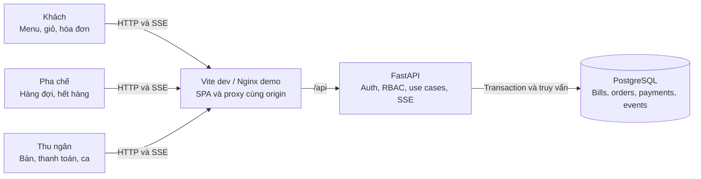
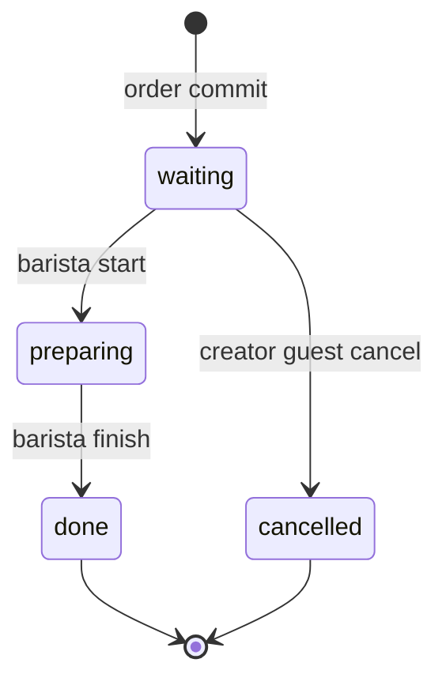
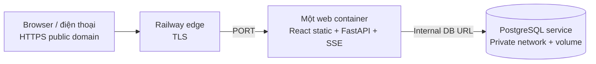
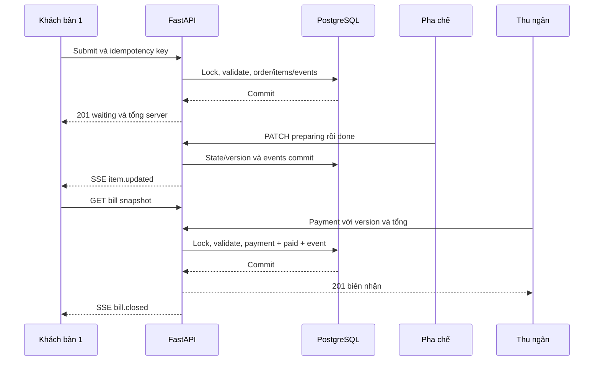

# TapOrder — PLAN chung frontend, backend và hệ thống

Ngày quyết định: 2026-11-03, Asia/Bangkok. Revision: PLAN-2, hoàn tất đặc tả kế hoạch frontend/backend, hệ thống, quyền, contract dự kiến, tasks, kiểm thử và demo. Đây là kế hoạch, chưa phải bằng chứng phần mềm đã chạy. Phạm vi lượt này: PLAN; chưa scaffold sản phẩm, chưa chạy hai agent sản phẩm, chưa tạo tài nguyên cloud. Mốc tiếp theo là CONTRACT, không phải triển khai ngay.

Hai ưu tiên bổ sung: **mục 7 — repo có sẵn và kế hoạch tinh chỉnh**, **mục 8 — thủ tục đưa webapp lên Internet**. Toàn bộ PLAN frontend/backend nằm chung file này; context chỉ ghi checkpoint.

Cập nhật sau PLAN theo yêu cầu chủ repo: [DESIGN-1](../docs/design/README.md) đã chi tiết hóa system/data/technical/API, F01–F12, test plan và [sơ đồ A–Z](../docs/design/product-flow.md). BD01 được làm trước C01/S01 trong lượt thiết kế; C01 vẫn bắt buộc trước code và làm song song. Các làm rõ concurrency bên dưới thống nhất với DESIGN-1; không triển khai app/deploy ở bước này.

Nguồn: yêu cầu Đề 2 TapOrder và bổ sung phân quyền của chủ repo trong chat; [agent guide](../agent.md), [template PLAN](product-plan.template.md), [playbook index](../playbook/README.md), [feature template](../docs/templates/feature-design.md). Đã đọc toàn bộ 10 Markdown trong playbook. Quy tắc repo hiện hành được ưu tiên hơn checkpoint cũ và ví dụ banking.

## 1. Bài toán, thuật ngữ và kết quả cần đạt

Quán cà phê cần thay ghi order tay bằng luồng QR đúng bàn → gửi món → pha chế theo thứ tự → thu tiền đúng hóa đơn. Có ba vai trò nghiệp vụ: khách hàng, pha chế, thu ngân. Khách không đăng nhập; hai vai trò nhân viên phải đăng nhập và có quyền khác nhau ở API lẫn UI.

| Thuật ngữ | Nghĩa duy nhất trong toàn bộ sản phẩm |
| --- | --- |
| Bàn / table | Vị trí vật lý, có mã số hiển thị và QR riêng ổn định |
| Phiên bàn / bill | Một hóa đơn cho một lượt phục vụ; `open` hoặc `paid`; không đồng nhất với browser session |
| Lượt gọi / order | Một lần gửi giỏ đã được server chấp nhận, thuộc một bill |
| Dòng món / order item | Một món + số lượng + ghi chú trong một lượt gọi; trạng thái áp dụng cho toàn dòng |
| Phiên khách / guest session | Danh tính ẩn danh bằng cookie, chứa quyền đối với các bill đã tham gia |
| Trạng thái món | `waiting` (chờ), `preparing` (đang pha), `done` (xong), `cancelled` (đã hủy) |
| Ca / shift | Khoảng thời gian thu ngân mở và đóng; doanh thu tính theo payment được xác nhận trong ca |
| Thanh toán | Thu ngân xác nhận đã thu tiền mặt; không có cổng thanh toán trực tuyến |

Tiêu chí thành công: hai browser độc lập gửi bàn 1 và bàn 3; pha chế nhìn thấy đủ hai lượt, đổi trạng thái một món; khách đúng bàn thấy cập nhật; thu ngân đóng bàn 1 đúng tổng; QR bàn 1 dùng được cho lượt mới mà không sửa bill đã trả tiền. Không rò dữ liệu bàn khác, không nhân đôi order/payment khi retry, không nhận thêm món vào bill đã đóng.

## 2. Phạm vi, quyết định nghiệp vụ và ưu tiên

### 2.1 Phạm vi

- P0: QR từng bàn; menu; giỏ, ghi chú, gọi thêm; ba vai trò và ba UI; hàng đợi pha chế; hóa đơn theo bàn; xác nhận tiền mặt và đóng bàn; hết hàng; hủy khi chờ; seed/demo; kiểm thử critical flows.
- P1 bắt buộc trong bản demo mục tiêu: cập nhật thời gian thực bằng SSE và phục hồi bằng polling. SSE là phương án tương đương WebSocket phù hợp dữ liệu chủ yếu server → browser.
- P2 làm sau khi P0/P1 đạt: gợi ý theo giờ/bán chạy, thống kê ca. Có thiết kế trong PLAN để không thêm schema tùy hứng; nếu thiếu thời gian, demo sáng tạo dùng P1, không tuyên bố P2 đã chạy.
- Ngoài scope: nhiều chi nhánh, đặt bàn, giao hàng, thanh toán gateway, chia/gộp/chuyển bàn, chia bill, hoàn tiền, sửa giá/menu CRUD, quản lý kho nguyên liệu, in hóa đơn phần cứng, tài khoản khách, quản trị user qua UI, mobile native, AI trả phí.
- Một quán, một ca đang mở; tiền VND không thuế/phụ phí/giảm giá trong MVP. Món được seed cố định, có thể bật/tắt còn hàng; số lượng tồn không được quản lý. Không suy ra nghiệp vụ ngân hàng từ playbook.

### 2.2 Quyết định nhóm phải trình bày

| ID | Quyết định | Lý do và hệ quả FE/BE |
| --- | --- | --- |
| D01 | Khách hủy toàn dòng do chính phiên khách tạo, chỉ khi `waiting`; không hủy một phần số lượng | Tránh khách bàn chung hủy đồ của người khác. `preparing/done` trả 409; khóa DB giải quyết race với pha chế |
| D02 | QR sau thanh toán vào menu cho lượt mới; GET không tạo bill. Chỉ lần submit đầu hợp lệ mới tạo bill `open` | Tránh hóa đơn rỗng do quét QR. Bill cũ giữ nguyên; tab cũ xem biên nhận và phải bấm “Bắt đầu lượt mới” để tham gia bill mới |
| D03 | Một món hết hàng làm toàn lượt gửi thất bại với 409 `ITEM_UNAVAILABLE` và danh sách món | Không nhận một phần âm thầm; giỏ và ghi chú giữ nguyên; khách sửa rồi gửi với key mới |
| D04 | Giá hiện tại khác giá khách thấy: toàn lượt trả 409 `PRICE_CHANGED`; khách xác nhận lại | Server tính tiền; mỗi dòng giữ snapshot giá/tên lúc order được chấp nhận |
| D05 | Một bàn tối đa một bill `open`; nhiều lượt gọi gộp đúng bill; nhiều khách có thể tham gia cùng bill | Guest chỉ nhìn bill đã tham gia, toàn bill xem được nhưng chỉ dòng của mình có nút hủy |
| D06 | Chỉ thanh toán khi tất cả dòng không hủy đã `done`; bill toàn dòng hủy được đóng với tổng 0 | Tránh đóng bàn khi quầy còn làm. Cần ít nhất một order đã tồn tại; không tạo bill rỗng để thu tiền |
| D07 | Tiền mặt một lần, không hoàn/mở lại bill `paid`; lưu payment duy nhất/bill kể cả tổng 0 | Đối soát đơn giản, retry không thu hai lần; sửa sai ngoài scope, phải thể hiện rõ ở demo |
| D08 | FIFO theo `order.created_at`, tie-break ID; gọi thêm giữ thứ tự của lượt gọi thêm | Không để bàn cũ gọi thêm chen lên trước; queue không dựa vào thời gian client |
| D09 | Pha chế bật/tắt hết hàng; thu ngân xem nhưng không đổi trạng thái pha chế | Phân quyền thực dụng, không thêm vai trò admin sản phẩm |
| D10 | Mở lại QR không chứng minh người đang ngồi thực tế; QR là capability để yêu cầu tham gia bàn | Demo chấp nhận rủi ro QR bị chia sẻ. URL ngẫu nhiên, rate limit, không cho đọc bill chỉ bằng số bàn; production cần kiểm soát tại quán nếu mở Internet |
| D11 | Ca bắt buộc để nhận order/thanh toán; thu ngân mở ca đầu demo; đóng ca chỉ khi không còn bill mở | Payment gắn ca lúc thu tiền; không có bill mở chạy qua ca trong MVP |

Không còn câu hỏi nghiệp vụ chặn PLAN. Đây là quyết định thiết kế của nhóm trong phạm vi đề cho tự quyết; thay đổi sau này phải cập nhật revision/contract/tests trước khi code. Exact dependency versions, CI branch protection thực tế và đích deploy chỉ chốt ở task tương ứng, không giả định đã tồn tại.

## 3. Thiết kế hệ thống tổng thể — trước thiết kế tính năng

### 3.1 Kiến trúc và ranh giới

Modular monolith: React SPA dùng chung API client → FastAPI → SQLAlchemy/services → PostgreSQL. PostgreSQL là nguồn chuẩn dữ liệu, trạng thái, tiền, quyền, sự kiện. Một API worker cho demo, không Redis/queue/microservices. SSE chỉ báo dữ liệu cần refetch; snapshot HTTP là nguồn chuẩn khi mất kết nối.



Mũi tên chỉ quan hệ request/data, không phải luồng thao tác. Không có tích hợp ngoài bắt buộc; QR sinh local, SSE và báo cáo không phụ thuộc dịch vụ bên thứ ba. Chuyển nhiều API worker là thay đổi kiến trúc sau MVP, phải đo lại fan-out/connection pool/rate limits.

### 3.2 Stack và môi trường

| Thành phần | Quyết định | Gate xác minh khi scaffold |
| --- | --- | --- |
| FE | React, TypeScript, Vite, Tailwind, shadcn/ui/Radix; TanStack Router/Query/Table; RHF + Zod; Zustand chỉ cho giỏ/UI | Kiểm tra upstream `satnaing/shadcn-admin`, MIT; giữ LICENSE/README upstream; bỏ UI mẫu không liên quan |
| BE | Python, FastAPI/Uvicorn, SQLAlchemy 2, psycopg 3, Alembic, Pydantic; Argon2 cho password | Khóa bản tương thích thực tế, không copy các version banking thành sự thật repo |
| Package manager | npm + `package-lock.json`; uv + `uv.lock`; pin Python/Node runtime, Docker images/digests | `npm ci`, `uv sync --frozen` trên môi trường sạch; ghi exact versions vào README và locks |
| Test | Vitest + Testing Library + MSW; pytest/httpx + PostgreSQL; Playwright cho demo critical E2E | Chỉ thêm dependency phục vụ test đã nêu; browser test nằm task integration |
| Dev | FE `127.0.0.1:5173`, API `127.0.0.1:8000`, DB dev `127.0.0.1:5432` | Vite proxy `/api`; FE không gọi DB; API docs local |
| Demo compose | Nginx UI `127.0.0.1:8080`, API/DB nội bộ mạng Compose, named volume dev/demo | `/api` giữ cookie/Origin, tắt proxy buffering cho SSE; migrate job xong trước API ready |
| Test | Compose project/DB riêng, DB test cổng 5433 nếu cần host access | Refuse chạy integration khi DSN trỏ DB dev; không xóa volume dev |
| Config | `.env.example` chỉ placeholder, `.env` ignored; DB URL, session secret, allowed origins, demo timezone, seed passwords | Fail startup nếu thiếu secret bắt buộc; không in password/token vào logs/context |

Dev/demo HTTP localhost cho phép cookie không Secure theo cấu hình rõ ràng; môi trường HTTPS phải Secure. Đề không yêu cầu public deployment: LAN/điện thoại thật hoặc Internet cần task riêng cấu hình origin, TLS, firewall và QR base URL. Demo bắt buộc dùng hai browser trên máy demo là đủ.

### 3.3 Chất lượng và vận hành mục tiêu

Đây là ngân sách nghiệm thu, chưa phải kết quả benchmark: 20 bàn, 50 khách đang mở trang, tối đa 5 màn nhân viên; menu 100 món; 1.000 order/ca. API thông thường p95 <= 500 ms, submit/thanh toán p95 <= 1 giây, trạng thái tới khách <= 2 giây khi SSE tốt; polling tối đa 5 giây sau mất stream. Đo trên máy demo, ghi cấu hình và workload; nếu không đo thì ghi “chưa đo”.

Health `/api/health/live` chỉ liveness; `/api/health/ready` kiểm DB/schema. Timeout DB transaction 5 giây, trả 503 có request ID khi không phục hồi. SSE heartbeat 15 giây, disconnect không đổi state, reconnect backoff 1/2/4/8/15 giây có jitter. Log JSON request ID, endpoint, actor ID ẩn danh/staff ID, latency, error code; audit các mutation. Không log cookie, CSRF, QR token, password hoặc nội dung ghi chú khách. Mục tiêu UI khách mobile từ 360 px; staff dùng tablet/desktop từ 768 px, có phương án cuộn hợp lý trên mobile.

## 4. Danh tính, phân quyền và ba giao diện

### 4.1 Nguồn quyền và phiên

- `guest`: tạo ẩn danh khi bootstrap, cookie HttpOnly riêng; không username/password. QR chứa token ngẫu nhiên tối thiểu 128 bit, DB chỉ lưu hash. Endpoint join xác minh token và cấp membership cho bill mở; khách không được tự đặt role hay table ID để lấy quyền.
- `barista`, `cashier`: user seed riêng với password băm Argon2, role từ DB; không cho đổi role trong UI, không tin role từ request. Không thêm admin UI. Tài khoản demo lấy từ biến môi trường ignored, không commit mật khẩu.
- Staff session opaque token hash trong DB, hết hạn 8 giờ tuyệt đối; guest session 12 giờ tuyệt đối. Membership bill tồn tại để xem biên nhận trong hạn session; session mới không được xem bill `paid` cũ qua QR. Hết session khách được join lại bill đang mở bằng QR, nhưng không nhận quyền hủy dòng của guest cũ; staff hỗ trợ theo quy trình quán, không nới quyền API.
- Hai cookie độc lập cho guest và staff để tab khách/staff trong cùng browser không ghi đè nhau. Một request xét đúng loại principal theo endpoint; staff không tự động thừa hưởng quyền guest. Cookie SameSite=Lax, Path=/, HttpOnly; Secure khi HTTPS. CSRF token riêng từng principal lấy qua bootstrap/session, giữ trong memory; mutation bắt `X-CSRF-Token` và exact allowlisted Origin, trừ health/read-only.
- Session cookie không lưu trong localStorage; logout/hết hạn xóa cache staff, đóng SSE; guest cache có key scope guest/bill. Không trộn cache khi chuyển role. IDOR test cho mọi resource: guest truy cập bill/item bàn khác trả 404; staff sai role trả 403, chưa đăng nhập trả 401.

### 4.2 Ma trận quyền backend và UI

| Chức năng/thao tác | Khách hàng | Pha chế | Thu ngân |
| --- | --- | --- | --- |
| Mở QR/menu | Bàn có QR hợp lệ; xem giá/còn hàng | Không phải thao tác staff; dùng route guest riêng nếu cần | Tương tự |
| Tạo/join bill | Dùng capability QR; chỉ bill mở của bàn đó | Cấm | Cấm tạo order thay khách trong MVP |
| Gửi order/gọi thêm | Chỉ bill có membership, còn `open` | Cấm | Cấm |
| Xem món/trạng thái/tổng tạm | Toàn bill đã tham gia; không xem bàn khác | Dòng hoạt động mọi bàn: bàn, món, lượng, note, thời gian; không giá/payment | Bill mọi bàn, dòng món, giá và tổng |
| Hủy món | Chỉ dòng của mình đang `waiting`, bill mở | Cấm hủy hộ; chỉ đổi tiến độ | Cấm hủy/đổi món |
| Đổi trạng thái | Cấm | `waiting → preparing → done`, mọi bàn, bill mở | Cấm |
| Đổi còn hàng | Chỉ đọc | Bật/tắt `available`, có version chống ghi đè | Chỉ đọc |
| Xem danh sách bàn/QR | Chỉ tên bàn mình trong phiên | Tên bàn trên queue; không xuất token QR | Xem bảng bàn, in/xem QR; QR là capability không phát công khai |
| Xác nhận tiền mặt/đóng bill | Cấm | Cấm | Bill mở đủ điều kiện; expected total/version |
| Xem bill đã trả tiền | Bill đã tham gia, trong hạn guest session | Không xem lịch sử tài chính | Xem lịch sử/biên nhận mọi bill |
| Mở/đóng ca | Cấm | Chỉ đọc ca có mở để vận hành | Được; đóng khi không còn bill mở |
| Gợi ý | Còn hàng, theo menu/giờ | Không có màn gợi ý | Không sửa thuật toán qua UI |
| Thống kê doanh thu/bán chạy | Cấm | Cấm | Xem theo ca; chỉ payment đã xác nhận |
| Tạo user/đổi role/giá | Cấm | Cấm | Cấm; seed/config ngoài UI |

Mọi quyền được kiểm tại router dependency + service resource scope, gồm SSE và read APIs; không chỉ ẩn nút. Response DTO riêng tránh lộ giá/doanh thu cho pha chế, token/actor ID của người khác cho khách. Guest chỉ nhận `can_cancel` và nhãn “Của bạn”, không ID danh tính người khác.

### 4.3 UI riêng

| Vai trò | Landing/navigation | Thành phần chính | Hành vi bị chặn |
| --- | --- | --- | --- |
| Khách | `/t/:qrToken`, `/guest/bills/:billId` | Header bàn nổi bật, danh mục món, card giá/còn hàng, nút giỏ, form note, danh sách lượt gọi, trạng thái dạng chữ, tổng tạm, biên nhận | Không sidebar nhân viên, không bảng bàn khác, không nút đổi tiến độ/thu tiền; link staff đưa tới login |
| Pha chế | `/staff/kitchen`, `/staff/kitchen/menu` | Hàng đợi FIFO, lọc chờ/đang pha/bàn, tuổi order, món/lượng/note lớn, hai nút bắt đầu/xong theo state; màn bật/tắt còn hàng | Không cột tiền, doanh thu, thanh toán hoặc menu cashier; route cashier bị guard và API 403 |
| Thu ngân | `/staff/cashier`, `/staff/cashier/bills/:billId`, `/staff/cashier/shift` | Grid bàn có trạng thái/tổng; bill nhiều lượt, dòng hủy ghi rõ; modal xác nhận số tiền; biên nhận qua bill ID; mở/đóng ca; QR; báo cáo P2 | Không nút làm món/hủy hộ/sửa giá; route kitchen bị guard và API 403 |

Sau login: server trả role, router chuyển đúng landing; truy cập route sai quyền hiện 403 với link quay lại màn được phép. Reload phải khôi phục session trước khi dựng màn, tránh ló nội dung sai role. Login pending khóa nút; 401 thông báo chung, 429 hiện thời gian thử lại. Keyboard focus, label rõ, vùng bấm >= 44 px; không dùng màu làm dấu hiệu duy nhất.

## 5. Dữ liệu, bất biến và đồng thời

### 5.1 Data model dự kiến cho migration

Tất cả ID UUID server tạo; thời gian `timestamptz` UTC, hiển thị Asia/Bangkok; tiền integer VND trong BIGINT, API chuỗi chữ số. Cột mặc định NOT NULL trừ đánh dấu `?`. `version` integer bắt đầu 1 tăng sau mỗi mutation đối tượng. Không hard-delete bill/order/payment/audit; FK nghiệp vụ RESTRICT. Schema cột chi tiết cuối cùng được viết tại bước detailed design trước migration.

| Bảng | Cột và constraint cốt lõi | Index/query |
| --- | --- | --- |
| tables | id PK, number int UNIQUE >0, label varchar(60), qr_token_hash UNIQUE, qr_token_encrypted, enabled bool default true, created_at | Hash lookup, encrypted token để cashier xuất lại QR, danh sách theo number |
| staff_users | id, username varchar(80) UNIQUE, password_hash, role enum barista/cashier, active bool | Login username |
| sessions | id, token_hash UNIQUE, kind guest/staff, staff_user_id? FK, csrf_hash, expires_at, revoked_at?, created_at; CHECK kind/staff FK tương ứng | Token; expiry cleanup; guest ID dùng session.id |
| shifts | id, status open/closed, opened_by FK staff, opened_at, closed_by?, closed_at?, version; chỉ 1 open qua partial unique index | Ca hiện tại; closed_at |
| bills | id, table_id FK, shift_id FK, status open/paid, version, opened_at, paid_at?, total_vnd?; CHECK paid có paid_at/total | Partial UNIQUE table_id WHERE status=open; table/time, shift/status |
| bill_memberships | bill_id FK + guest_session_id FK composite PK, joined_at | Scope lookup theo guest/bill |
| menu_categories | id, name varchar(80), sort_order int | Thứ tự menu |
| menu_items | id, category_id FK, name varchar(120), description varchar(500), price_vnd BIGINT >0 <=10000000, available bool, active bool, version | Category/active/sort; seed menu |
| orders | id, bill_id FK, created_by_session_id FK, created_at, order_number BIGINT generated UNIQUE | bill/created_at; queue created_at/id |
| order_items | id, order_id FK, menu_item_id FK, name_snapshot, unit_price_vnd BIGINT >0, quantity int 1..20, note varchar(250), status enum, version, started_at?, done_at?, cancelled_at? | order_id; status/order_id; snapshot và time checks |
| payments | id, bill_id FK UNIQUE, shift_id FK, cashier_id FK, method=cash, amount_vnd BIGINT >=0, paid_at | shift/paid_at, bill UNIQUE |
| idempotency_records | id, principal_kind/id, operation, key UUID, payload_hash, response_status, response_json, created_at, expires_at; UNIQUE scope/operation/key | Retry lookup; giữ tối thiểu 24 giờ |
| domain_events | id BIGINT PK cấp từ event_clock dưới lock cuối transaction, bill_id? FK, audience guest/kitchen/cashier/menu, event_type, resource_type/id, aggregate_version, created_at | audience/id; bill_id/id, retention 24 giờ; cursor theo commit, xem DESIGN-1 |
| audit_events | id, request_id, principal_kind/id, action, resource_type/id, before_state?, after_state?, created_at | resource/time; không chứa secrets/note text |

DESIGN-1 bổ sung bảng nội bộ `preauth_sessions`, singleton `shift_guard` và `event_clock`; [data model](../docs/design/data-model.md) là chi tiết migration. Không thêm tính năng sản phẩm.

Bill total mở tính server SUM(unit_price_snapshot * quantity) với status != cancelled, không lấy tổng từ client; closed bill lưu snapshot và đối soát payment cùng transaction. Line max 200.000.000 VND; tối đa 50 dòng/lượt và tổng bill <= 1.000.000.000 VND, vượt trả 422 `BILL_LIMIT_EXCEEDED`. Note được trim, text thuần, không HTML; quantity là integer, không nhận float/0/số âm. Không gộp các dòng khác ghi chú; cùng món/note có thể là dòng riêng.

### 5.2 State và bất biến



`waiting → preparing → done` là đường duy nhất của pha chế; không quay lùi/nhảy bước. `paid` là terminal của bill; payment không thay state món. `can_pay` chỉ true nếu mọi dòng `done/cancelled` và ca mở. Table UI: rảnh khi không có bill mở, phục vụ khi có bill mở, sẵn sàng thanh toán khi can_pay; không lưu thêm trạng thái table dễ lệch.

Bất biến phải bảo vệ bằng DB + service: một bill mở/bàn; một payment/bill; một order/mutation thành công cho một idempotency key; snapshot giá bất biến; cancelled không tính tiền; role/scope đúng ở cả read/write/stream; sự kiện và audit chỉ tồn tại cùng transaction đã commit; lỗi trước commit không để lại bill/order/payment dở dang.

### 5.3 Transaction/lock và race

Thứ tự khóa toàn cục cho mutation: idempotency reservation → shift_guard → ca hiện tại → table → bill → menu_items theo UUID tăng dần → order_items theo UUID tăng dần → event_clock. Chỉ lấy các khóa cần thiết nhưng không đảo thứ tự. Guard và ca dùng shared row lock cho order/payment, exclusive cho open/close; table/bill dùng `FOR UPDATE`. Guard có sẵn cả khi chưa có ca. READ COMMITTED với truy vấn kiểm tra lại sau khi đã khóa. Ca đóng kiểm bill mở dưới exclusive lock nên không đua tạo bill. Snapshot đọc/cursor và event commit-order theo [technical design](../docs/design/technical-design.md).

| Race | Quy tắc và hậu điều kiện |
| --- | --- |
| Hai submit đầu cùng bàn | Cùng khóa table; submit null đến sau trả TABLE_VISIT_CHANGED, không tự join. Khách xác nhận/join rồi gửi key mới mới có 1 bill/2 order; partial unique index là hàng rào cuối |
| Submit gọi thêm và thanh toán | Cùng table/bill lock. Submit trước làm tăng version và có món chờ nên payment từ snapshot cũ 409; payment trước thì submit bill cũ 409 `BILL_CLOSED`, không tự chuyển sang bill mới |
| Hủy và pha chế bắt đầu | Khóa bill rồi item, kiểm expected_version/state; một thắng, một 409; không có dòng vừa cancelled vừa preparing |
| Hết hàng và submit | Submit khóa menu row, availability update cũng khóa menu row; quyết định theo trạng thái commit được serialize, không nhận order nếu hết hàng đã commit trước |
| Hai thu ngân thanh toán | Khóa bill + UNIQUE payment; một thành công; key cũ replay, key khác 409 BILL_CLOSED; không nhân đôi payment |
| Mất mạng sau commit | Retry cùng key và cùng payload trả response cũ trước kiểm tra state mới; chỉ replay sau khi xác thực quyền phù hợp; payload khác 409 IDEMPOTENCY_CONFLICT |

Idempotency áp dụng submit, cancel, status, availability, payment, open/close shift. Scope theo principal + operation + key; transaction INSERT unique reservation, khi concurrent trùng chờ kết quả rồi đọc bản committed. Rollback không lưu response thành công; 4xx không cache, retry chỉnh input dùng key mới. Sau 24 giờ key có thể hết hạn: FE không tự retry command cũ, phải đối soát snapshot/order history và yêu cầu thao tác mới. Lock timeout/deadlock rollback và trả 503 `RETRYABLE_CONFLICT`, client giữ key; tối đa 2 retry có backoff, sau đó báo chưa xác định và cho đối soát.

## 6. Seed, phục hồi và giới hạn triển khai

Seed idempotent: **đúng hai bàn số 1 và 3**, tối thiểu 3 danh mục/12 món (cà phê, trà, khác), hai user `barista.demo`/`cashier.demo` từ env. QR sinh cùng base URL đang chạy, không hardcode localhost cho deployment khác; raw token và mật khẩu chỉ trong output local ignored, không commit. Seed không tự tạo payment/order giả ở mode demo; fixtures tests riêng để kết quả đối soát được. Mỗi lần demo thu ngân mở ca; dùng bill mới thay vì xóa dữ liệu.

Migration Alembic từ DB sạch → seed → health → login. Test nâng cấp từ revision liền trước khi có migration thứ hai; review SQL/destructive operations. Backup logical DB trước migration demo có dữ liệu; restore thử ở DB riêng trong rehearsal release nếu có thay schema. Rollback ưu tiên image/commit trước có schema tương thích; destructive migration không tự downgrade/xóa volume. Với migration phá tương thích phải có kế hoạch restore được phê duyệt trong task release. Dữ liệu order/payment giữ toàn bộ trong demo; events/idempotency dọn sau 24 giờ bằng maintenance command explicit, không tự xóa bill/audit. Guest/session hết hạn revoke và purge token theo job, audit vẫn giữ actor reference ẩn danh.

## 7. Repo có sẵn và kế hoạch tinh chỉnh

### 7.1 Khảo sát và clone đã thực hiện

Đã tìm repo cùng chủ đề, clone ba ứng viên, đọc manifests/README và file nguồn liên quan. Clone nằm trong `.local-tools/references/` đã ignored, không đẩy nguyên source/nested Git lên origin. Chưa install dependencies, chạy SQL, app hoặc deploy repo nguồn. Nhận định là static review tại SHA dưới đây, chưa phải runtime/security acceptance.

| Repo / SHA đã clone | Stack quan sát | Mức phù hợp và lựa chọn |
| --- | --- | --- |
| [roshanx0/restaurant-ordering-saas](https://github.com/roshanx0/restaurant-ordering-saas), `59216d745ab480cd72f8e5b537374835b33473d0` | React/TS/Vite/Tailwind, React Router, Supabase JS/Realtime, có file MIT LICENSE | **Chọn nguồn UI nghiệp vụ chính**: menu/cart/order cards/reports; phải thay data/auth, QR theo bàn và bill nhiều lượt. Port có chọn lọc vào stack FE của repo; BE FastAPI theo contract TapOrder |
| [RameezBadruddinKhwaja/Restaurant-Ordering-QR-Menu-System](https://github.com/RameezBadruddinKhwaja/Restaurant-Ordering-QR-Menu-System), `89e1bf78fd38dcf17b3c127d899a19c6e7708f58` | Next.js/Express/Prisma/PostgreSQL/Redis/Socket.IO | Tạo order đòi login, role ADMIN/RESTAURANT_OWNER không khớp; chưa thấy kitchen UI trong cây app. README/package khai MIT nhưng không có root LICENSE trong clone. Không chọn nền, chưa copy code |
| [omairakapasha/qr-ordering-rag](https://github.com/omairakapasha/qr-ordering-rag), `6574ec7975d32a119aed06333edcd26c14d0efcd` | Express/TS, Drizzle/PostgreSQL, HTML server-rendered; FastAPI cho AI, có pnpm lock/tests | Sát QR bàn/no login/queue/tiền mặt nhưng UI không React, AI ngoài scope; file LICENSE là AGPL-3.0. Tham khảo luồng/test, không copy source vào lựa chọn MIT hiện tại |

Clone local tương ứng: `.local-tools/references/restaurant-ordering-saas`, `.local-tools/references/restaurant-qr-menu`, `.local-tools/references/qr-ordering-rag`. Tái lập bằng clone HTTPS repo rồi checkout SHA đã ghi (fetch SHA nếu shallow clone thiếu). Giữ origin nguồn trong clone riêng, không sửa origin TapOrder. Các báo cáo “production-ready” trong README không phải kết quả kiểm chứng của nhóm.

### 7.2 Findings repo chủ repo đề xuất

Đã đọc [database tại revision pin](https://github.com/roshanx0/restaurant-ordering-saas/tree/59216d745ab480cd72f8e5b537374835b33473d0/database). SQL có thật là `database/setup.sql`; `database/README.md` hướng dẫn `database/schema.sql` nhưng file đó không tồn tại ở clone. Không chạy SQL theo README khi chưa đối chiếu.

| Bằng chứng ở source pin | Khoảng thiếu TapOrder | Tinh chỉnh bắt buộc |
| --- | --- | --- |
| `CustomerMenu.tsx`: checkout tự nhập bàn/tên/phone, tính thuế 5%, gửi subtotal/tax/total từ client | Sai QR đúng bàn, thừa thông tin cá nhân và tổng không do server quyết định | Bỏ các input/thuế/takeaway; QR resolve bàn, note mỗi dòng, API server tính tiền |
| `setup.sql`: `orders.items` JSONB, trạng thái trên order, chưa có bảng bill/payment riêng | Chưa có gọi thêm cùng bill và per-item status | Viết schema mục 5/Alembic; không import SQL Supabase nguyên bản |
| `restaurantService.ts`: browser gọi Supabase insert/update/subscriptions trực tiếp | Không đi qua FastAPI | Thay bằng generated API client và SSE; bỏ Supabase keys/client khỏi bundle |
| `Orders.tsx`: user từ localStorage; login RPC SQL so sánh hash client cung cấp | Không đáp ứng session/RBAC của TapOrder | Cookie opaque session, Argon2, CSRF, quyền server; không port login/RPC |
| SQL public INSERT orders `WITH CHECK (TRUE)`; owner policies dựa `auth.uid()` trong khi app có login RPC riêng | Chuỗi identity/RLS cần kiểm chứng, chưa có bằng chứng phân quyền đủ | Không tái sử dụng policies; negative API authorization tests bắt buộc |
| Trigger order number COUNT + 1 theo ngày; update status nhận string | Race mã order, enum/state không theo TapOrder | Sequence/UUID; state machine + expected_version server |
| README và package versions lệch; có package-lock.json ở SHA pin nhưng chưa chạy npm ci/build | Chưa xác minh clean install/build hoặc compatibility stack đích | Giữ stack `agent.md`, kiểm lock nguồn và khóa dependency stack đích tại scaffold |
| `Reports.tsx` tính theo order statuses | Chưa đối soát doanh thu thực thu theo ca | Query payments + dòng không hủy, không cộng bill chưa paid |

Đây là khoảng thiếu qua static review, không tuyên bố đã khai thác lỗ hổng. Không copy credential demo/config Supabase của upstream vào context/sản phẩm.

### 7.3 Bản đồ giữ/chỉnh/viết mới

| Nguồn | Phần có thể giữ | Phải thay | Gate |
| --- | --- | --- | --- |
| `src/pages/customer/CustomerMenu.tsx` | Bố cục menu card/filter/cart drawer | Tách MenuPage/MenuCard/CartDrawer, RHF/Zod, TanStack Query, Zustand cart theo table/visit; dữ liệu qua contract | Mobile 360px, hết hàng có nhãn, state lỗi/retry đúng |
| `src/pages/restaurant/Orders.tsx` | Ticket layout/FIFO/note/số lượng | Kitchen riêng, state từng dòng; cashier riêng; quyền/DTO tách | Barista không giá/payment, cashier không nút làm món |
| Reports/QR patterns | Card/chart/QR rendering nếu cần | Bill/ca/payment thật, QR bàn token, VND/thời gian quán | Không dùng số tổng client hoặc fixtures trong live |
| UI primitives | Chỉ phần có giá trị, giữ attribution MIT | Hợp nhất với shadcn-admin/shadcn, một Router/design system | Không mang hai bộ Button/Dialog/Router trùng nhau |
| Data/auth/realtime | Tham khảo trải nghiệm, không giữ implementation | FastAPI/SQLAlchemy/Postgres, cookie/CSRF/RBAC, SSE; bỏ Supabase RPC | Unit/integration/contract/IDOR checks |

Task adaptation sau CONTRACT: pin SHA → tạo `frontend/README.upstream.md` và `frontend/THIRD_PARTY_NOTICES.md`, giữ MIT notice nguồn và template → liệt kê file nguồn/file đích → port component vào stack đích → thay service/router/auth/DTO → bỏ SaaS registration/approval/subscription, demo accounts, Stripe/AI → lock dependency → lint/type/build/unit → context/diff/commit/push/remote SHA. Không copy nested `.git`, `.env`, vendor tree, ảnh không rõ quyền sử dụng. User cho phép chọn repo ngôn ngữ khác không tự động bỏ backend Python đã chốt; việc thực hiện adaptation sản phẩm nằm sau PLAN/CONTRACT, không thay clone khảo sát bằng tuyên bố app đã chạy.

## 8. Deploy webapp nhanh — thủ tục cụ thể

### 8.1 Hướng triển khai chính và phương án dự phòng

**Chọn Railway: một Docker Web Service chứa React build + FastAPI, một PostgreSQL service riêng có volume.** FastAPI phục vụ static/SPA sau `/api`; browser dùng tương đối `/api/v1`, cùng một domain HTTPS cho ba UI, cookie và SSE. Local vẫn PostgreSQL Docker Compose. Đây là thiết kế giảm cấu hình origin, chưa có tài nguyên/URL thật. Railway có hướng dẫn FastAPI/GitHub và PostgreSQL template dựa image Postgres. Nguồn: [FastAPI Railway](https://railway.com/guides/fastapi), [PostgreSQL Railway](https://docs.railway.com/databases/postgresql).



| Hướng | Đánh đổi | Lựa chọn |
| --- | --- | --- |
| Railway Docker web + PostgreSQL | Hai services, một domain public, database private | Ưu tiên demo sớm; một API replica/worker |
| Render Docker web + Render Postgres | Cùng-origin tương tự; DB managed thay container mình quản lý | Dự phòng, runbook mục 8.5 |
| VPS + Docker Compose + TLS proxy | Đúng stack nhưng cần máy chủ/SSH/firewall/domain/DNS/backups | Chỉ khi có VPS sẵn |
| Vercel/Netlify chỉ FE | Frontend nhanh nhưng vẫn thiếu API/DB; tách origin thêm cookie/proxy | Không chọn cho demo đầu; chỉ deploy UI không tính full webapp |

Tại ngày tra cứu 2026-11-03, Railway Hobby ghi mức subscription $5/tháng và tính usage; không coi đây là tổng giá app+DB. Trước tạo resource phải kiểm lại quota/trial/billing/usage limit của tài khoản và chọn ngân sách. Chưa mua/nâng gói. Nguồn: [Pricing Railway](https://docs.railway.com/pricing/plans). Ước lượng nội bộ deploy lần đầu 30–60 phút **sau khi** image/migration/seed/gates sẵn sàng, không phải thời gian dựng sản phẩm từ số 0.

### 8.2 Chuẩn bị từ scaffold — DEP-01

1. Root `Dockerfile` multi-stage: Node `npm ci`/build FE → Python `uv sync --frozen --no-dev` → copy FE dist vào static. Pin base images, non-root, `.dockerignore` loại secrets/Git/clones/node_modules. Không đưa secrets vào ARG hoặc `VITE_*`.
2. ASGI entrypoint `app.main:app`, runtime workdir `/app/backend`; entry script đọc `PORT` platform, mặc định 8000 local, host `0.0.0.0`. Một Uvicorn worker/replica; không `--reload` hay Vite dev trên cloud.
3. API routes trước static/SPA: reload `/t/...`, `/staff/...`, `/guest/...` trả index; asset thiếu 404, API thiếu JSON 404, không fallback thành HTML 200. Hashed assets cache dài, index cache ngắn/no-cache.
4. Settings validate DATABASE_URL, SESSION_SECRET, APP_ENV, PUBLIC_BASE_URL, ALLOWED_ORIGINS/HOSTS, COOKIE_SECURE, DEMO_TIMEZONE, LOG_LEVEL, APP_VERSION, ENABLE_MOCKS=false. Chuyển DB URL sang driver `postgresql+psycopg` bằng parser, không log DSN. TLS DB theo provider, không tự tắt verify cho public DB.
5. Alembic command có sẵn trong image; seed command riêng idempotent, passwords qua private env; không reset bills khi restart. CLI/API xuất QR lấy PUBLIC_BASE_URL được tin cậy, không lấy Host tùy ý.
6. Ready kiểm DB/schema. SSE content-type event-stream, no-cache/no buffering/compression, heartbeat 15s; trust proxy headers đúng phạm vi để nhận HTTPS. Không dùng DB connection bị giữ suốt vòng đời stream.
7. Build/run image local với Docker DB: login, QR, order/payment, deep-link reload, SSE và negative RBAC. Gate đạt → context/commit/push. Chưa tạo Dockerfile giả trước app; ghi config lặp lại `railway.toml/json` khi scaffold có command thực tế.

### 8.3 Deploy Railway lần đầu — DEP-02

| Bước | Thao tác | Kết quả phải thấy |
| --- | --- | --- |
| 1. Account | Đăng nhập Railway, liên kết GitHub, chỉ cấp repo TapOrder; kiểm plan/credit/usage alerts và budget | Có quyền tạo project; không ghi cloud token vào Git |
| 2. Release | Chọn SHA đã pass local/hosted CI, nhánh release dự định `codex/taporder-demo` khi tạo; không nhánh PLAN chỉ Markdown | Ghi SHA + rollback baseline; không tự đổi default/protected branch |
| 3. PostgreSQL | New Project → thêm PostgreSQL, volume persistent, cùng project/region app | DB healthy, internal DB URL; không mở public DB nếu không cần |
| 4. Web | Deploy from GitHub → repo/nhánh release; root repo build context, root Dockerfile | Log nhận Dockerfile, đúng locks; image không chứa env/clones |
| 5. Variables | Reference DATABASE_URL từ DB service; các env mục 8.2, secret mạnh, Secure cookie; seed password private | Startup fail nếu thiếu env; bundle không chứa secret/service-role key |
| 6. Start/health | Entrypoint exec Uvicorn app.main:app, đọc PORT, host 0.0.0.0; health `/api/health/ready`, một worker/replica | DB/schema ready 200; Host guard cho phép health probe provider |
| 7. Migrate | Settings pre-deploy `uv run --no-sync alembic upgrade head` từ `/app/backend`, timeout 300s | Exit 0 mới chuyển traffic, lỗi thì dừng release; không migration trong image build |
| 8. URL HTTPS | Settings → Networking/Public Networking → Generate Domain; lấy domain thật, set PUBLIC_BASE_URL/Origins/Hosts, apply/redeploy | TLS hợp lệ, không mixed content; không dùng domain ví dụ làm bằng chứng |
| 9. Seed | One-off command đúng service/env `uv run --no-sync python -m app.seed`, sau migration | Menu/hai bàn 1 và 3/hai staff; không orders/payment giả, không in password vào logs; gỡ seed env khi không cần |
| 10. QR và ca | Cashier đăng nhập, lấy QR bàn 1/3 từ domain public, mở ca | QR không localhost; mở điện thoại mạng di động được; guest không cần account |
| 11. Smoke public | Kiểm đủ hai bàn/role/SSE/payment/new visit, reload, persistence, quyền sai | Có URL/SHA/time/evidence; không suy cloud pass từ CI |
| 12. Handoff | Lưu deployment ID, schema revision, DB backup, URL ba UI, rollback SHA, checks/issues; commit/push context | Chỉ gọi deploy thành công khi UI/API/DB thật hoạt động |

Commands trên là interface **dự kiến tạo tại scaffold**, hiện chưa có để chạy. Nếu account không có one-off shell, dùng provider CLI có quyền trong đúng environment hoặc seed command một lần đã kiểm soát; không expose seed endpoint public. Không paste credentials/DSN vào báo cáo. Domain/custom domain miễn phí do provider cấp đủ demo, chưa cần mua domain.

Railway pre-deploy chạy trong container riêng có env/private network nhưng không mount volume app; dùng migrate DB, không xuất QR/file cần giữ. Command fail chặn deploy. Nguồn: [Pre-deploy](https://docs.railway.com/deployments/pre-deploy-command). Public networking cung cấp HTTPS/domain; app nghe PORT và ready 2xx trước chuyển traffic. Health gate không phải monitoring liên tục. Nguồn: [Networking](https://docs.railway.com/networking/public-networking), [Healthchecks](https://docs.railway.com/deployments/healthchecks). Root Dockerfile được phát hiện; không giả định platform hiểu toàn bộ Compose local. Nguồn: [Dockerfiles](https://docs.railway.com/builds/dockerfiles).

### 8.4 Update và rollback — DEP-03

1. Nhánh `codex/<task>` → regression nếu đổi behavior → gates → context/diff/commit/push/verify SHA; PR/merge release theo quyền repo. Job tổng hợp required-gates không được skipped/neutral. Demo đầu manual deploy SHA; không mỗi push tài liệu đều deploy.
2. Backup DB trước migration có dữ liệu, review compatibility app cũ/mới; deploy đúng image/commit, migrate pre-deploy, ready rồi traffic. SSE disconnect/reconnect không được gửi trùng order.
3. Smoke deployed: hai staff, guest QR, tạo/gọi thêm, món → preparing/done, thanh toán, QR lượt mới, RBAC negative, reload và restart persistence. Ghi evidence không secrets.
4. Nếu sai order/payment: bật maintenance chặn thao tác mới, giữ logs/request ID; chọn previous successful deployment/redeploy SHA đã biết tốt. Kiểm schema tương thích trước rollback code. Rollback image **không rollback DB**; schema phá tương thích phải restore có kiểm soát sang DB mới từ backup, không xóa volume.
5. Đối soát payment đã commit trước lỗi, không thu lại; smoke lại, ghi incident/SHA/schema/next owner; chỉ resume khi dữ liệu khớp.

### 8.5 Render dự phòng

Liên kết GitHub/chọn release SHA → tạo Postgres và Docker Web Service cùng region → root Dockerfile chứa FE+FastAPI, bind `0.0.0.0:$PORT` → internal DB URL + env/cookie/origin như trên → migration pre-deploy nếu gói hỗ trợ; nếu không, release/start command có DB advisory lock một replica rồi mới server → seed riêng một lần → domain HTTPS/PUBLIC_BASE_URL/QR → cùng smoke suite. Không migrate trong image build. Nguồn: [Docker Render](https://render.com/docs/docker), [FastAPI Render](https://render.com/docs/deploy-fastapi), [DB connection](https://render.com/docs/postgresql-creating-connecting).

Free Render có sleep sau 15 phút idle, cold start, filesystem tạm; DB free hết hạn 30 ngày và không có backups tích hợp. Kiểm quota/expiry trước demo, không coi free là lưu dữ liệu bền vững dài hạn; ưu tiên instance không sleep theo ngân sách. Nguồn: [Free limitations](https://render.com/docs/free). SSE vẫn phải kiểm stream/heartbeat/reconnect qua HTTPS thật; loại Web Service phù hợp long-lived connections nhưng không chứng minh app đã pass. Nguồn: [Web service](https://render.com/tutorials/web-service-vs-static-site/web-services).

Render Auto-Deploy “After CI Checks Pass” tính cả neutral/skipped là pass: phải có required-gates thật sự chạy checks cần thiết. Manual SHA giữ Auto-Deploy Off trong demo. Rollback ở Deploys → previous successful deploy → Rollback; dashboard rollback tắt autodeploy và không restore DB. Nguồn: [Deploys](https://render.com/docs/deploys), [Rollbacks](https://render.com/docs/rollbacks).

### 8.6 Chẩn đoán nhanh

| Lỗi | Kiểm theo thứ tự | Không tính hoàn tất nếu |
| --- | --- | --- |
| 502/ready fail | PORT/bind/workdir/start logs → DB URL/schema → allowed host health probe | Chỉ FE tĩnh lên |
| Deep link reload 404 | SPA fallback sau API, asset base path | Phải vào từ homepage mới chạy |
| Login lặp/CSRF 403 | HTTPS/forwarded scheme, Secure/SameSite, exact Origin, cookie guest/staff | Bỏ CSRF/role cho chạy |
| QR điện thoại không vào | PUBLIC_BASE_URL public HTTPS, sinh lại QR, thử mobile data | QR còn localhost/LAN |
| Không live | stream type/buffering/compression, heartbeat, auth scope, reconnect/poll | Poll cũng lỗi hoặc lộ events bàn khác |
| Mất order sau redeploy | DB/volume đúng, không SQLite/local memory, seed không reset | Data chỉ còn trong cache |
| CI xanh cloud lỗi | So deployed SHA, env/secrets/network/migration và smoke | Chưa chạy flow hai bàn thật |

Cloud account/quyền GitHub/budget là dependency DEP-02, không chặn PLAN. Lượt này chưa tạo tài nguyên tính phí, chưa public deployment; sau khi app có sẵn dùng runbook trên để thực hiện.

## 9. Danh mục tính năng và đặc tả nghiệp vụ

Các mục 3–6 là system design trước feature design. CONTRACT sẽ chuyển đặc tả dưới thành schema/examples kiểm tra tự động trước khi chia hai agent.

| ID | Actor / ưu tiên / phụ thuộc | Acceptance chính |
| --- | --- | --- |
| F01 | Guest / P0 / seed,F02 | QR bàn 1/3 mở menu đúng bàn, không login; token sai/disabled404; GET không tạo bill |
| F02 | Tất cả / P0 / schema | Guest bootstrap, staff login/logout/session; sai role403, thiếu phiên401, sai scope404 |
| F03 | Guest / P0 / F01,F02,F08 | Giỏ quantity/note, submit và gọi thêm cùng bill; giá server, atomic, retry không trùng |
| F04 | Guest / P0 / F03 | Xem bill đã tham gia, hủy dòng mình khi waiting; cancelled không tính tiền |
| F05 | Barista / P0 / F02,F03 | Queue FIFO mọi bàn, waiting→preparing→done từng dòng; không giá/payment |
| F06 | Barista / P0 / F02 | Bật/tắt còn hàng; submit kiểm DB; không sửa order đã nhận |
| F07 | Cashier / P0 / F03,F05,F08 | Tổng từng bàn, xác nhận cash, 1 payment/bill; paid terminal, lượt mới qua QR |
| F08 | Cashier / P0 / F02 | Một ca mở; không đóng khi còn bill; ngoài ca không nhận order |
| F09 | Guest/staff / P1 / F03–F08 | SSE đúng scope, fallback polling5s, reconnect/refetch không trùng mutation |
| F10 | Cashier / P0 / F01,F02 | Xuất QR riêng đúng hai bàn1/3, URL đúng môi trường |
| F11 | Guest / P2 / F01 | Gợi ý tối đa3 món còn hàng theo giờ/bestseller, không tự thêm giỏ |
| F12 | Cashier / P2 / F07,F08 | Doanh thu thực thu theo ca, bill paid và top5 món; loại dòng cancelled |

### 9.1 F01/F03 — QR, giỏ và gọi thêm

1. `/t/{qr_token}` bootstrap guest cookie/CSRF, resolve table và current_bill_id nullable. Hiển thị bàn cố định, không input đổi bàn; menu GET không tạo bill.
2. POST join gửi QR và expected_bill_id nullable. Có bill đúng expected thì tạo membership; chưa có thì trả null, không tạo bill. Nếu bàn vừa đổi lượt trả409 TABLE_VISIT_CHANGED và yêu cầu xác nhận join lượt hiện tại.
3. Giỏ theo table/visit; mỗi dòng menu_item_id, quantity1..20 integer, note trim<=250, expected_unit_price_vnd; tối đa50 dòng. FE validate Zod, server validate lại; hết hàng giữ dòng cũ có cảnh báo.
4. Submit gửi QR, expected_bill_id và items, CSRF/Idempotency-Key. Không nhận client total/role/table tùy ý. Service reserve key → khóa ca/table/bill → kiểm ca mở/table enabled/membership/expected bill → khóa menu theo UUID → kiểm giá/availability/giới hạn tiền.
5. expected_bill_id null chỉ tạo nếu chưa có bill; nếu browser khác vừa tạo, trả TABLE_VISIT_CHANGED để khách xác nhận join rồi gửi lệnh mới. Expected bill thật đã paid trả BILL_CLOSED, không âm thầm chuyển lượt.
6. Insert bill nếu cần + membership + order/items waiting + version + events/audit/key trong một transaction;201 trả order và bill tổng server. Chỉ clear giỏ sau success/replay. Lỗi trước commit không thêm bill/order/items;409/422 giữ giỏ, highlight món. Timeout giữ payload/key, retry cùng key.

Làm rõ race ở mục5.3: luôn một bill mở; submit thứ hai có thể conflict trước join, sau xác nhận hai order được nhận vào cùng bill. Membership mới cho phép đọc bill; token/số bàn riêng lẻ không cho đọc lịch sử paid.

### 9.2 F04–F06 — hủy, pha chế và hết hàng

- Hủy: kiểm membership và creator trước state; khóa bill/item, compare expected_version; waiting→cancelled, tăng item/bill version, event/audit.200 trả item/tổng mới;409 STATE_CONFLICT/VERSION_CONFLICT refetch, không toast thành công. Không DELETE lịch sử, không hủy một phần quantity.
- Queue waiting/preparing nhóm order, sort created_at/id tăng, có bàn/quantity/note/tuổi ticket. Chỉ nút Bắt đầu khi waiting, Xong khi preparing; pending disable. Server role + bill open + expected_version + legal transition, cùng lock với hủy. State đổi tăng bill version;409 refetch. DTO không có giá/payment/guest identity.
- Toggle availability cần barista, expected_version, khóa menu row, event/audit; không sửa snapshots cũ. Guest nhận menu event/refetch; submit vẫn kiểm DB. Toggle commit trước submit thì cả lượt409 ITEM_UNAVAILABLE, không nhận một phần.
- Audit actor/action/resource/state/version, không note/secrets. Tests PostgreSQL thật cho cancel/start, availability/submit, permission/projection.

### 9.3 F07/F08 — thu tiền và ca

- Cashier mở ca trước demo. Open unique, key cũ replay, key mới khi đã mở409 SHIFT_ALREADY_OPEN. Close khóa exclusive ca, nếu bill mở409 OPEN_BILLS_EXIST; không thay status ca. Sau hết bill mới closed/audit.
- Bill UI nhóm các lượt, dòng hủy có nhãn và không tính tiền. can_pay từ server; disable thanh toán kèm số dòng chưa xong. Dialog cash/tổng server, không input giảm giá/thuế/giá tự nhập.
- Payment gửi expected_bill_version, expected_total_vnd, method=cash. Auth/RBAC/CSRF → key → shared lock ca → table/bill lock → kiểm open/version/tổng/tất cả done hoặc cancelled. Conflict409 VERSION_CONFLICT/AMOUNT_CHANGED/ITEMS_NOT_DONE giữ dialog và refetch.
- Cùng transaction insert payment unique, bill paid/paid_at/total/version, events/audit/key;201 sau commit mới hiện receipt/bàn free. Bill tổng0 vẫn payment0. Retry key cũ cùng payment; key mới BILL_CLOSED. Không refund/reopen.
- Tab guest cũ giữ receipt read-only; giỏ chưa gửi có cảnh báo, không tự chuyển lượt. Bấm Bắt đầu lượt mới xác nhận bỏ giỏ cũ/resolve/join lại. Quét QR GET chỉ vào menu, bill mới sinh ở submit; paid bill không đổi.

### 9.4 F09–F12 — SSE, reuse QR và sáng tạo

- SSE scoped guest bill/menu, kitchen, cashier. Events chỉ id/type/resource_id/version/time; không nhúng giá vào kitchen. Snapshot HTTP authoritative; mutation ghi event cùng transaction, dispatcher chỉ đọc committed.
- Snapshot có event_cursor, mở stream từ cursor để không mất khoảng giữa đọc/subscribe. Poll DB nội bộ1s/batch, release connection giữa lần đọc; heartbeat15s; Last-Event-ID hoặc after khi mở stream mới. Cursor ngoài retention gửi reset để refetch. FE dedupe event IDs, debounce150ms, không retry POST vì reconnect.
- Kiểm session/scope khi connect và mỗi batch; expired/revoked đóng stream, HTTP401. Badge đồng bộ/reconnect/poll5s; stream healthy dừng polling. Event trùng không nhân order/payment.
- Nguồn QR thật: [RestaurantSettings.tsx tại SHA pin](https://github.com/roshanx0/restaurant-ordering-saas/blob/59216d745ab480cd72f8e5b537374835b33473d0/src/pages/restaurant/RestaurantSettings.tsx) có QRCodeSVG và SVG→canvas→PNG; value hiện `/menu/{restaurant.slug}`, chưa theo bàn. Port render/export thành TableQrCard, ref riêng từng card, server URL `/t/{token}`, filename table-1.png/table-3.png, SVG fallback nếu PNG lỗi; giữ MIT notice. Bỏ Supabase/localStorage auth của nguồn.
- Để xuất lại QR sau restart: bổ sung `tables.qr_token_encrypted` authenticated encryption, key QR_ENCRYPTION_KEY trong env; hash dùng lookup. Seed sinh token một lần, không rotate khi chạy lại. Cashier-only endpoint giải mã, no-store/audit, không log URL/token. Mất key phải restore key backup hoặc explicit rotate/in lại QR.
- F11 dùng giờ quán Asia/Bangkok:06–11 cà phê,11–17 trà, còn lại khác; tối đa3 active/available, bổ sung bestseller7 ngày rồi sort seed khi thiếu; UI ghi lý do. Bestseller từ quantities không cancelled thuộc bill paid. F12 SUM payments theo shift, paid bill count, top5 quantity giảm/ID tie-break. Chỉ cashier; P2 không chặn demo nếu P1 đạt.

## 10. Contract dự kiến và baseline

### 10.1 Quy ước

Base `/api/v1`; UUID string, timestamp UTC ISO8601 Z; tiền VND integer truyền **chuỗi decimal**; quantity/version integer. Success `{data:...}`, list `{data:[],meta:{next_cursor:null,limit:50}}`, error `{error:{code,message,details,request_id}}`; unknown fields422, nullable khai rõ, DTO whitelist không serialize ORM.

Cookie staff/guest tách biệt, mutation CSRF+Origin. GET auth/bootstrap cấp preauth cookie/CSRF TTL10 phút, login phải gửi token này/Origin rồi rotate staff session; guest bootstrap POST kiểm Origin chỉ tạo anonymous session/context, không join/tạo bill. Login401 INVALID_CREDENTIALS generic. Rate limits dự kiến login5/phút/IP+username, bootstrap/join30/phút/IP, order10/phút/session, staff mutation60/phút/session;429 Retry-After; memory limiter chấp nhận một worker demo.

Mutation nghiệp vụ mục5.3 có UUID Idempotency-Key; thiếu422.401 khôi phục phiên,403 không retry,404 generic scope,409 refetch/sửa lệnh với key mới,422 field errors,503 rollback retry cùng key. Timeout chưa rõ commit: replay/đối soát trước tạo mới. Replay order cũ đã commit trên bill paid được cho principal gốc; không áp BILL_CLOSED lên replay đã xác thực.

### 10.2 Endpoint inventory

Mọi đường dẫn dưới base trừ health mục3.3. Mutations áp CSRF/key trừ login/bootstrap/logout dùng chính sách phiên riêng.

| Method/path | Quyền | Request | Success / lỗi chính |
| --- | --- | --- | --- |
| GET /auth/bootstrap | Public | — |200 csrf_token/preauth cookie |
| POST /auth/login | Preauth |username,password |200 staff{id,username,role},csrf_token;401/429 |
| GET /auth/session | Staff |— |200 staff,expires_at,csrf_token;401 |
| POST /auth/logout | Staff |CSRF |204 revoke/xóa cookie; logout lại Origin hợp lệ204 |
| POST /guest/bootstrap | Public+Origin |qr_token |200 guest_id,csrf_token,table,current_bill_id nullable;404 |
| POST /guest/join | Guest+QR |qr_token,expected_bill_id nullable |200 bill_id nullable,membership; TABLE_VISIT_CHANGED |
| GET /guest/menu | Guest |category_id optional |200 categories/items/version/event_cursor |
| POST /guest/orders | Guest+QR/membership |expected_bill_id,qr_token,items |201 order/bill; SHIFT_CLOSED/BILL_CLOSED/ITEM_UNAVAILABLE/PRICE_CHANGED |
| GET /guest/bills/{id} | Membership |— |200 BillDTO;404 |
| POST /guest/items/{id}/cancel | Creator+membership |expected_version |200 item/bill summary; STATE_CONFLICT |
| GET /kitchen/queue | Barista |cursor,limit |200 tickets/event_cursor/shift_open, sort created_at/id |
| PATCH /kitchen/items/{id}/status | Barista |status preparing/done,expected_version |200 item; INVALID_TRANSITION/VERSION_CONFLICT |
| GET /kitchen/menu | Barista |— |200 active items/availability/version, không giá |
| PATCH /kitchen/menu/{id}/availability | Barista |available,expected_version |200 item; VERSION_CONFLICT |
| GET /cashier/tables | Cashier |— |200 bàn1/3,derived status,bill_id,total,version,event_cursor |
| GET /cashier/bills/{id} | Cashier |— |200 BillDTO/payment nullable |
| POST /cashier/bills/{id}/payments | Cashier |expected_bill_version,expected_total_vnd,method |201 receipt; ITEMS_NOT_DONE/AMOUNT_CHANGED/BILL_CLOSED |
| GET /cashier/shifts/current | Cashier |— |200 shift nullable |
| POST /cashier/shifts | Cashier |{} |201 shift; SHIFT_ALREADY_OPEN |
| POST /cashier/shifts/{id}/close | Cashier |expected_version |200 shift; OPEN_BILLS_EXIST |
| GET /cashier/tables/{id}/qr | Cashier |— |200 table_number,url; no-store/audit |
| GET /guest/bills/{id}/events | Membership |after optional |200 event-stream;401/404 |
| GET /guest/menu/events | Guest |after optional |200 menu event-stream |
| GET /kitchen/events | Barista |after optional |200 kitchen/menu events |
| GET /cashier/events | Cashier |after optional |200 cashier/menu events |
| GET /guest/recommendations | Guest/P2 |— |200 tối đa3 items/reasons |
| GET /cashier/shifts/{id}/report | Cashier/P2 |— |200 revenue_vnd,paid_bill_count,top_items |

Queue cursor opaque base64 sort tuple; limit default50,1..100, invalid cursor422. FE event refetch page đầu/merge ID; done/cancelled rời queue nhưng còn bill. Menu/hai bàn không paginate, report top5 cố định. Không thêm CRUD do template có sẵn.

### 10.3 Examples và DTO

IDs dưới chỉ fixtures, không phải IDs/credentials thật. Seed cà phê sữa30.000/trà đào35.000 VND.

```json
{"qr_token":"<token từ QR>","expected_bill_id":null,"items":[{"menu_item_id":"00000000-0000-4000-8000-000000000001","quantity":2,"note":"Ít đá","expected_unit_price_vnd":"30000"}]}
```

201 trả `data:{order:{id,order_number,created_at,items:[{id,menu_item_id,name,unit_price_vnd,quantity,note,status,version,is_mine,can_cancel}]},bill:{id,table_number,status,version,total_vnd,can_pay},event_cursor}`. BillDTO gồm id/table_id/table_number/status/version/opened_at/paid_at nullable/total_vnd/can_pay/orders/payment nullable/event_cursor. Kitchen projection bỏ price/total/payment/guest identity. can_pay/can_cancel là server-computed, không cấp quyền guest trả tiền.

```json
{"expected_bill_version":5,"expected_total_vnd":"60000","method":"cash"}
```

201 trả `data:{payment:{id,bill_id,shift_id,amount_vnd,method,paid_at},bill:{id,status:"paid",version:6,total_vnd:"60000"},table:{number:1,status:"free"}}`.

```json
{"error":{"code":"ITEM_UNAVAILABLE","message":"Có món vừa hết hàng. Vui lòng sửa giỏ.","details":{"items":[{"menu_item_id":"00000000-0000-4000-8000-000000000001","reason":"unavailable"}]},"request_id":"req-example"}}
```

SSE gồm `id:42`, `event:item.updated`, data resource_id/version/occurred_at. Enum events `order.created,item.updated,menu.updated,bill.closed,shift.updated,reset,session.expired`; client refetch bill/queue/tables/menu theo audience. Hủy dùng item.updated, state đọc từ snapshot.

### 10.4 Gate CONTRACT tiếp theo

Coordinator tạo `contracts/openapi.yaml` OpenAPI3.1 và examples success/empty/401/403/404/409/422/429/503, SSE riêng, CONTRACT-1. Canonical YAML sinh FE types bằng generator pin; Pydantic DTO đối chiếu schema/fixtures tự động; `/openapi.json` phục vụ canonical validate. Tests so route registry/method/path/status/security và validate HTTP response thực bằng JSON Schema; không chỉ trả YAML rồi coi API tuân thủ.

Gate validator/examples pass, generated types diff sạch, enums/nullable/error đầy đủ không TODO interface, hai phía cùng revision. Đổi contract: coordinator sửa schema/examples trước, notify owners, regenerate types/mock/design/tests cùng revision trước merge. Hiện **chưa có canonical contract**, PLAN không thay gate này.

## 11. Frontend chi tiết

### 11.1 Route, role, dữ liệu và thao tác

| Route | Actor/layout | Nội dung/API/actions và states |
| --- | --- | --- |
| /t/{qr_token} | Guest mobile/header bàn/giỏ sticky |Bootstrap/join/menu; category/search client/MenuCard/NoteDialog/CartDrawer; skeleton, QR error, empty, soldout, price conflict, submit pending/retry |
| /guest/bills/{id} | Membership |Timeline lượt/dòng/status/total, hủy dòng mình, gọi thêm; SSE badge, error/retry, paid receipt/Bắt đầu lượt mới |
| /staff/login | Staff public form |Username/password/show-hide, pending/error, session redirect role; không role selector |
| /staff/kitchen | Barista |FIFO tickets bàn/note/qty/time, Bắt đầu/Xong; empty/loading/conflict; không giá/tab thu ngân |
| /staff/kitchen/menu | Barista |Search/toggle available confirm; pending/rollback conflict; không sửa giá |
| /staff/cashier | Cashier/sidebar Bàn-QR-Ca |Hai TableCard1/3, rảnh/phục vụ/can_pay,total; CTA mở ca; loading/error/retry |
| /staff/cashier/bills/{id} | Cashier |Chi tiết lượt/cancelled/tổng, PaymentDialog/receipt; chặn chưa xong, conflict refetch |
| /staff/cashier/qr | Cashier |Hai QR card/copy link/download SVG/PNG, no-store, export fallback |
| /staff/cashier/shift | Cashier |Mở/đóng ca, cảnh báo bill mở; P2 report thực, không dashboard giả |
| /403 và not-found | Tất cả |Thông báo và link về đúng principal, không lộ cache cũ |

Guard loader đọc server session; sidebar theo role chỉ UX, API vẫn cưỡng chế. Guest/staff cookies độc lập; hai staff khác role dùng browser profiles riêng. CTA có handler thật hoặc không xuất hiện.

### 11.2 Tổ chức, form/cache và mock

- `frontend/src/{routes,components/ui,components/layout,features/guest,features/kitchen,features/cashier,features/auth,api/generated,api/client,mocks,stores/cart}`. Một TanStack Router/design system; UI roshan port chọn lọc.
- Client fetch credentials same-origin, CSRF theo principal, tiền string. Query key gồm session/principal/table/bill; logout/đổi role clear cache/đóng stream. Zustand giỏ memory; sessionStorage chỉ item/qty/note/table/visit, không QR token/cookie/CSRF. Reload phải resolve visit/đối chiếu giá trước gửi.
- RHF/Zod login/note/qty; password không trim, note trim250, quantity integer. Không optimistic order/payment/state; success mới clear/invalidate. Pending disable tránh double click nhưng key server vẫn bắt buộc.
- Submit refetch bill dù SSE chưa đến. Event debounce150ms, một stream/audience, window focus/reconnect refetch; polling5s khi stream mất. QR raw token giữ memory/current route, không đưa analytics/logs.
- MSW đúng HTTP contract, scenarios normal/two-tables/empty/soldout/price-changed/version-conflict/expired/paid/reconnect. Không page import fixtures; ENABLE_MOCKS chỉ dev/test, production fail nếu bật. Live API lỗi hiện error, không mock fallback.
- Intl vi-VN hiển thị; tổng authoritative server. Guest360px/staff768px; nút>=44px, focus visible/label, Dialog keyboard/Escape/focus restore, trạng thái có text/icon/live region debounce. Không autoplay âm thanh.

## 12. Backend chi tiết

`backend/app/{main,config,db,models,schemas,api,services,domain,repositories,security,events}`, `alembic/`, `tests/{unit,integration,contract}`. Domain thuần totals/transitions/can_pay/rules; service transaction/key; repository ORM/parameterized SQL; route parse/auth/DTO/status. Không gọi DB/Supabase từ browser.

| Module | Trách nhiệm / DB / tests |
| --- | --- |
| auth/security |Argon2/session/preauth/CSRF/RBAC/membership; rotate/revoke/expiry8h và12h; generic login error; cookie/Origin/negative permissions tests |
| tables/guest |QR hash resolve, cashier decrypt export, join membership, expected visit;404 và TABLE_VISIT_CHANGED; audit export không token |
| menu |Active menu DTO, kitchen không giá, availability locked/versioned/events; race và XSS note plain text |
| ordering |Ca/table/bill/menu locks, snapshots/order/items/limits, key; atomic reject/order.created/audit; concurrent/replay/rollback tests |
| kitchen |Indexed FIFO query/transition locked, state+version+bill open; cancel race và projection tests |
| billing |Bill snapshot/can_pay/cancel own waiting, immutable receipt; totals exclude cancelled |
| payments/shifts |Unique payment/open shift, totals/version, close lock; payment+paid atomic; concurrent payments/close-vs-create tests |
| events |Durable scoped cursor/heartbeat/reset/expiry; batch DB connection ngắn, read-only delivery |
| reports P2 |Payments shift/top quantities paid, giờ server; không cộng open/cancelled, tests biên06/11/17 |

DB session ngắn/request, transaction explicit commit một lần/service, exceptions rollback/close; SSE không giữ connection suốt stream. FK không cascade financial rows. Active shift unique constant expression WHERE open; bill unique table WHERE open. Queue index order created_at/id, item status/order; report payment shift/paid_at. Timestamps UTC, giờ quán Asia/Bangkok, không clock client.

DB lỗi503/request_id, không partial success; timeout sau commit replay. Runtime DB role không superuser, migration role riêng. Body<=64KB; note plain text; headers Referrer-Policy:no-referrer, path QR redact logs; QR route không third-party analytics/assets. Không tắt CSRF/CORS để chữa integration.

## 13. Luồng sản phẩm A–Z

A migrate/seed hai bàn, cashier login/mở ca/xuất QR. B hai guest browsers mở QR1/3, bootstrap/join/menu/gửi. C barista login/queue/bắt đầu/xong, guest SSE/refetch. D gọi thêm cùng bill hoặc hủy own waiting; conflict lấy trạng thái server. E cashier đọc tổng/thanh toán sau done/cancelled, receipt bất biến. F tab cũ paid read-only, QR menu cho lượt mới, chỉ submit mới sinh bill. G đối soát/đóng ca khi hết bill/logout.



Mỗi request là transaction riêng, không giữ submit chờ pha chế/thu tiền. SSE có thể trùng/trễ; snapshot/version authoritative. Lỗi trước commit không ghi order/payment; mất mạng sau commit cần replay/đối soát trước lệnh mới.

## 14. Task graph, ownership và checkpoint Git

| Task | Owner/nhánh dự kiến | Depends | Artifact và done |
| --- | --- | --- | --- |
| PLAN-S2 |Coordinator/codex/taporder-plan |S1/source review |File này, DEMO.txt/context; docs checks/commit/push/SHA |
| C01 |Coordinator/codex/taporder-contract |PLAN-2 |OpenAPI/examples/revision1; validate/types gate |
| S01 |Coordinator/codex/taporder-scaffold |C01 |Manifests/locks/Compose DB-test/Docker/scripts/CI nền; clean install/checks |
| FE01 |Frontend agent/codex/taporder-frontend |C01+S01 cùng SHA đã push |frontend/** UI/mock/QR/client; unit/lint/type/build/mock acceptance |
| BD01 |Backend design agent/codex/taporder-backend-design |C01+S01 cùng SHA |docs/design/{README,system-design,technical-design,data-model,product-flow,test-plan,features/F01..F12}; algorithms/locks/errors/expected DB/testcases reviewed |
| BE01 |Backend implementation owner/codex/taporder-backend |BD01 reviewed+C01 |backend/** migrations/seed/auth/order/kitchen/payment/SSE; unit→integration PostgreSQL/contract/lint/type |
| INT01 |Coordinator/codex/taporder-integration |FE01+BE01 cùng contract |Merge/live no mocks, origin/cookies/CSRF/errors, two-table E2E/restart persistence |
| DEMO01 |Coordinator/codex/taporder-demo |INT01 |QR/local account TXT/rehearsal evidence; local và hosted checks riêng |
| DEP01–03 |Release owner/khi được giao |DEMO01+quyền cloud/budget |Runbook8/deployed smoke/rollback evidence; không deploy trong PLAN |

Đồ thị gốc PLAN→C01→S01→(FE01 song song BD01)→BE01→INT01→DEMO01→DEP nếu được giao. Cập nhật theo yêu cầu thiết kế hiện tại: BD01 có DESIGN-1 trước C01/S01; nhánh thực thi tiếp là C01→S01→FE01/BE01 từ cùng baseline contract đã push. Chưa chạy hai agent sản phẩm. Lúc được giao coordinator tạo worktree/nhánh riêng; FE sở hữu frontend, BE backend, coordinator contracts/plans/context tổng. Agent code backend chỉ nhận sau design review và contract/scaffold gates, không tự đổi task BD thành implementation.

Mỗi task hoàn chỉnh: checks đúng scope → context agent riêng/HANDOFF/WORKLOG tổng → review/stage đúng file → Conventional Commit → fetch/check divergence → push origin nhánh → local HEAD so ls-remote. Không force/đổi remote/gom file owner khác. Contract đổi qua coordinator/revision/notify, merge contract/scaffold trước FE/BE rồi live gate; merge source chưa phải tích hợp. Không dừng xin phép mỗi mốc đã giao; lượt này dừng đúng scope PLAN.

## 15. Kiểm thử và CI/CD

### 15.1 Acceptance → test và DB hậu điều kiện

| Test | Features/cấp | Fixture/thao tác và kết quả phải đạt |
| --- | --- | --- |
| T01 |F01,F10/integration+browser |Decode QR1/3 đúng labels/URL; sai404; GET không thêm bill |
| T02 |F02/integration |2 staff, wrong role, IDOR, missing/wrong CSRF:401/403/404 và0writes; kitchen không giá/payment trong DTO/stream |
| T03 |F03/unit+integration |Qty0/21/float,note251,lines51,price/soldout:422/409 và0partial bill/order/items, cart giữ |
| T04 |F03/concurrent PostgreSQL |2 submit đầu cùng bàn, join sau conflict/gọi thêm:1open bill,2orders khi cùng được nhận, snapshots/tổng đúng |
| T05 |F03,F07/integration |Same key/payload replay; khác payload409; timeout sau commit:1order/payment |
| T06 |F04,F05/unit+concurrent |Cancel/start cùng version:1thắng/1conflict, state chỉ cancelled hoặc preparing; guest khác không hủy |
| T07 |F05/unit+integration |waiting→done/done→waiting409 unchanged; legal chain thành công |
| T08 |F06/concurrent |Hết hàng commit trước submit409 toàn lượt; order đã nhận không đổi snapshots |
| T09 |F07/integration |Pay khi waiting/preparing409/0payment; done rồi pay2lần chỉ1payment/paid; tổng0 hợp lệ |
| T10 |F03,F07/concurrent |Gọi thêm đua pay/stale total/version:serialize, không order vào paid, conflict409 |
| T11 |F08/integration |Open2ca chỉ1open; close còn bill409 unchanged; paid hết rồi close được |
| T12 |F09/integration+browser |Commit event, reconnect/cursor cũ/reset/expiry, scoped no leak; duplicate event không duplicate POST |
| T13 |F01,F07/E2E |Paid bàn1→QR→submit mới:bill ID khác, old paid unchanged; tab cũ BILL_CLOSED |
| T14 |P2/unit+integration |Giờ06/11/17, unavailable,open/paid/cancelled:rule đúng, report payments/paid only |
| T15 |Integration/browser+DB |Submit/gọi thêm/reload/restart API/readback:DB còn dữ liệu, mock off, không fallback |
| T16 |Demo/E2E |2guest contexts+2staff profiles, đủ script mục16 và negative permissions |

Behavior regression fail trước khi practical, unit trước integration; không dùng SQLite/mock để chứng minh locks Postgres. DB test DSN guard, migration từ sạch, test fixtures riêng, không xóa volume dev. Domain totals/transitions/auth mục tiêu coverage>=80% khi cấu hình, không thay concurrency cases. Performance mục3 chưa đo thì ghi chưa đo.

### 15.2 Commands dự kiến tạo ở S01, chưa chạy

| Working directory | Gates dự kiến |
| --- | --- |
| frontend/ |npm ci; npm run format:check; npm run lint; npm run typecheck; npm run test:unit; npm run build |
| backend/ |uv sync --frozen; uv run ruff format --check .; uv run ruff check .; uv run mypy app; uv run pytest tests/unit -q |
| backend/ với DB test |uv run alembic upgrade head; uv run pytest tests/integration tests/contract -q |
| root/tools |npm run contract:check; npm run generate:check; docker compose config; docker compose build |
| e2e/ |npm ci; npm run test:demo, Playwright với API thật/DB biệt lập/mock off |

Commands là interface acceptance cho scaffold, chưa có manifests nên không claim tồn tại/pass. Pin validator/generator trong tools lock; không tải latest ngẫu nhiên. Sinh routes TanStack trước tsc nếu cần. Security gates npm audit --audit-level=high và uv run pip-audit dependency pin; high/critical xử lý hoặc documented exception cụ thể, không auto audit-fix phá locks.

### 15.3 Hosted CI và CD

Chưa pipeline để reuse. S01 tạo GitHub Actions ci.yml: PR/push codex/** và default branch thực đọc từ origin; docs-only docs checks. contents:read, concurrency theo branch. Jobs docs, contract, FE frozen install/check/test/build, BE frozen install/lint/type/unit/integration với PostgreSQL service healthy, critical E2E sau FE/BE/contract, dependency audit. Runtime/images/actions pin khi tạo.

required-gates always đọc needs/path changes: app changes bắt jobs cần thiết success thật; docs-only chỉ pass sau docs check, không biến skipped thành app pass. Fork PR không production secrets, test credentials riêng; cache theo lock hash; reports không cookies/password/QR; không pull_request_target chạy code không tin cậy. Branch protection cần cấu hình remote/quyền, ghi actual checks sau khi tồn tại, không claim YAML đã bật protection.

CD manual release chỉ khi được giao, chọn SHA CI pass, image/migration/ready/smoke/rollback mục8. Push PLAN không deploy. Local checks, hosted CI, deployed acceptance ba trạng thái riêng.

## 16. Demo hai bàn, account TXT và yêu cầu bất ngờ

Hướng dẫn mang đi demo: [DEMO.txt](../DEMO.txt). Public TXT ghi usernames/quy trình, mật khẩu và QR thật trong `.local-tools/demo/accounts.txt` ignored do seed/export tạo ở implementation/demo; không commit secrets. Hiện chưa app/tài khoản thật; không dùng account upstream làm account TapOrder.

Seed đúng bàn1/3; cà phê sữa30.000/trà đào35.000. Rehearsal: DB ready/migrate/seed, env passwords, export TXT riêng đủ account/URLs/QR, decode QR, mở ca. Guest Chrome profileA bàn1, Edge/profileB bàn3; staff profilesC/D để không đè staff cookie.

| Bước | Trình diễn | Quan sát |
| --- | --- | --- |
| 1 |A bàn1 gọi2cà phê ít đá; B bàn3 gọi1trà đào |Hai bill60.000/35.000, queue đủ2lượt |
| 2 |Barista cà phê waiting→preparing→done |Guest bàn1 nhận SSE/refetch; không leak bàn1 sang bàn3 |
| 3 |Bàn1 gọi thêm1trà đào và làm xong |Cùng bill, tổng95.000; FIFO lượt gọi thêm |
| 4 |Cashier pay bàn1 cash |1payment95.000, paid/free, bàn3 vẫn35.000 chưa trả |
| 5 |Mở lại QR1, submit1cà phê |GET chưa tạo bill, submit bill ID mới30.000; old paid95.000 không đổi |
| 6 |Hủy own waiting, thử sau preparing, toggle hết hàng lúc đang chọn |Hủy chờ được/sau pha409; soldout giữ giỏ,0partial order |
| 7 |Ngắt/kết nối mạng guest khi barista đổi state |Badge reconnect/poll, refetch đúng, không thêm order; sáng tạo P1 |
| 8 |P2 chỉ trình diễn nếu đã pass |Không trình bày fixtures/report giả thành live |

Yêu cầu bất ngờ chưa biết, không claim làm sẵn. Chuẩn bị nhánh codex/taporder-demo-change từ demo SHA đã push: ghi yêu cầu/acceptance → contract trước nếu đổi interface → regression fail khi practical → sửa đúng scope → unit/integration/FE gates affected → context/diff/commit/push/SHA → demo before/after. Rehearsal ví dụ đổi luật hủy preparing phải sửa domain/API/can_cancel UI/race tests, không chỉ nút. Refund/split ngoài giới hạn cần chốt tradeoff/scope trước, giữ baseline demo. Rollback code bằng revert/known-good release, không xóa payment.

## 17. Gate bàn giao PLAN và việc tiếp theo

PLAN-2 bao phủ frontend/backend chung file, system trước features, ba role/actions/resource/UI, data/state/race, contract dự kiến/examples/errors, routes/cache/mock, backend algorithms, owners/tasks, tests/CI, reuse QR và demo hai bàn. Không còn quyết định nghiệp vụ chặn CONTRACT; versions/branch protection/cloud budget thuộc task sau.

Gate PLAN: requirements/template review, headings/fences/internal links/diff/secrets/consistency; context; commit/push và verify remote SHA. Mermaid source review, nếu chưa render ghi chưa render. App build/types/lint/unit/integration/hosted CI/deployed checks chưa chạy vì chưa app; PLAN không là bằng chứng demo pass.

Next owner coordinator C01 canonical contract/examples/validation → S01 scaffold/locks/CI → FE01 song song BD01 trên worktrees. Lượt này chỉ PLAN, chưa khởi chạy implementation/deploy.
